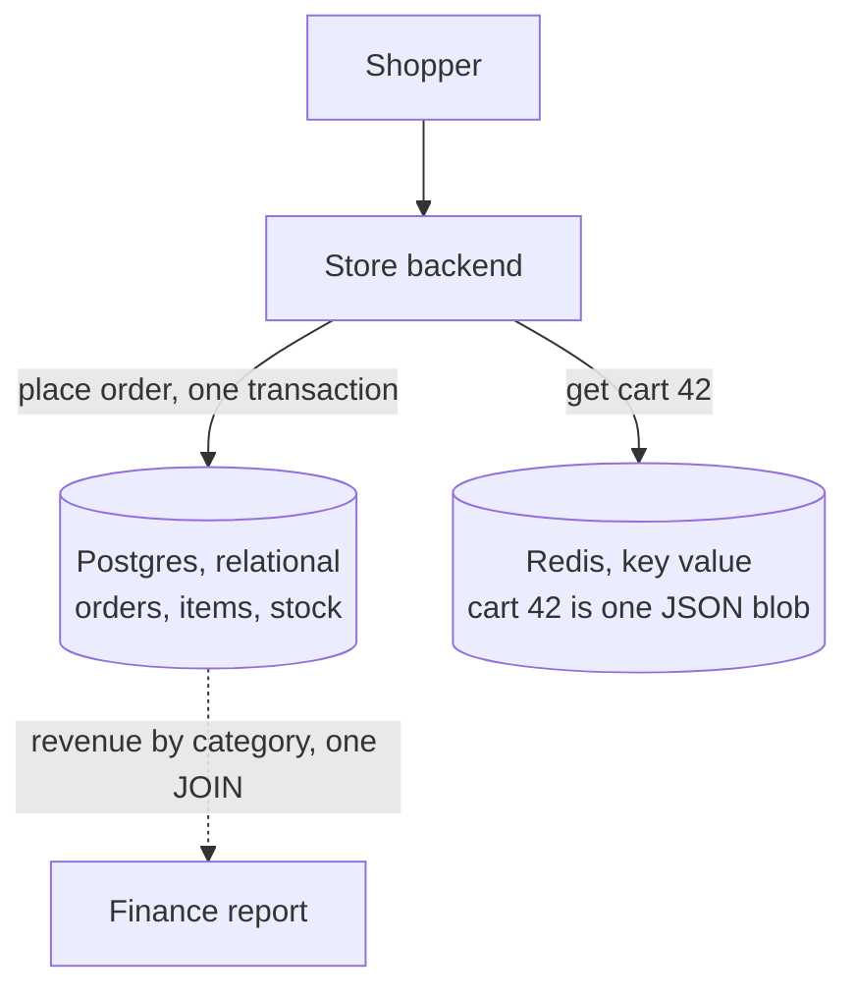

# SQL vs NoSQL

> SQL databases store data in tables you can join and change together safely. NoSQL is a family of other shapes, each built to answer a few known questions fast at huge scale.

## How it works

A relational database, like Postgres or MySQL, keeps data in tables with fixed columns. Rows point at each other by ID, and a join stitches them back together at query time. You can ask questions nobody planned for, and transactions keep related changes all or nothing.

NoSQL is the catch all name for everything else. The four main shapes:

- **Document.** Each record is a JSON blob with nested data inside. MongoDB is the famous one.
- **Key value.** A giant hash map: give it a key, get back a value. Redis and DynamoDB.
- **Wide column.** Rows found by a partition key and spread across many machines, built for heavy write traffic. Cassandra.
- **Graph.** Nodes and edges, for questions like "friends of friends who live in Berlin". Neo4j.

The big myth is that NoSQL is always faster. A Postgres lookup by primary key is already fast, often under a millisecond. NoSQL stores feel fast because you shape the data around the exact queries you'll run, and many of them spread across machines without much work. Ask a question you didn't plan for, and there's often no join to save you.

So start relational unless you have a specific reason not to: a known access pattern at a scale one machine can't hold, a firehose of writes, or data that really is a graph. Postgres even stores JSON well, which covers a lot of "but my data is flexible".

The catch: teams pick NoSQL "for scale" at 10,000 users, then spend a year rebuilding joins and transactions in application code.

## Example

An online store has two kinds of data with very different needs.

Orders, payments, and stock levels go in Postgres. Placing an order has to insert the order, its line items, and take one kettle out of stock, all or nothing. Finance also wants revenue by category for last month, which is one join and a `GROUP BY`.

Shopping carts go in Redis, keyed by user ID. The store only ever asks one question about a cart: "give me cart 42". No joins, read on every page view, thrown away after 7 days.

Neither store is the "fast" one. Both answer their own question in about a millisecond. They're just shaped for different questions, and the store uses each for the questions it's good at.

## Picture it

Each kind of data goes to the store shaped for its questions. Orders need joins and transactions, so they live in tables. A cart is only ever fetched by one key, so a key value store is plenty.

## Related

[ACID Transactions](acid-transactions.md) · [Normalization vs Denormalization](normalization-vs-denormalization.md) · [Storage Engines](../08-storage/storage-engines.md) · [Sharding](../09-data-at-scale/sharding.md) · [CAP Theorem](../10-distributed-systems/cap-theorem.md)
