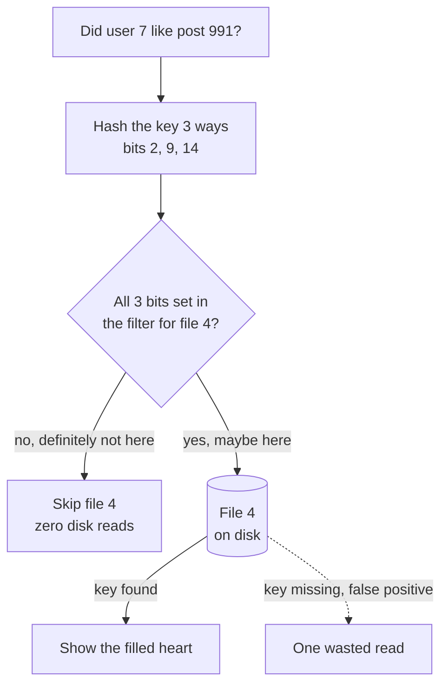

# Bloom Filters

> A Bloom filter is a tiny bit array that answers "is this item in the set?" with either "definitely not" or "maybe yes". Systems use it to skip expensive lookups for things that aren't there.

## How it works

Start with an array of bits, all set to 0, and a few hash functions. To add an item, hash it, say, 3 ways and set those 3 bits to 1. To check an item, hash it the same 3 ways and look at those bits.

If any of the 3 bits is 0, the item was never added. That answer is certain. If all 3 are 1, the item is probably there, but other items might have set those bits. That's a false positive. There are never false negatives.

The knobs are size and the number of hashes. About 10 bits per item, with the right number of hashes, gives roughly a 1% false positive rate. A filter for 100 million keys fits in about 125 MB of memory, while the keys themselves could take many gigabytes.

The big use is skipping disk reads. LSM databases like Cassandra keep a Bloom filter in memory for every data file on disk, and RocksDB does the same once you turn filters on. Before opening a file to look for a key, they ask its filter, and "definitely not" means skip the file.

There are limits. You can't remove an item, because clearing its bits might erase other items too. And you can't list what's inside. It only answers "could this be here?"

The catch: you size it up front. Put in 5 times the items you planned for and most bits turn to 1. The filter says "maybe" to almost everything and saves you nothing. Rebuild it bigger as the data grows.

## Example

A social feed shows a filled heart on every post you've liked. Likes live in an LSM store keyed by user and post, spread across 20 data files on disk.

Loading a feed checks 50 posts, and you've liked maybe 5 of them. Without filters, each of the 45 misses has to look in all 20 files. That's 900 disk reads just to learn "no" 45 times.

With a Bloom filter per file at a 1% false positive rate, a miss only opens a file when its filter wrongly says "maybe". That's about 9 wasted reads across the whole feed instead of 900. The 5 real likes cost roughly one read each, and the hearts load in a few milliseconds instead of a few hundred.

## Picture it

The filter lives in memory and costs nothing to ask. Only a "maybe" touches the disk, and only the rare false positive wastes that trip.

## Related

[Storage Engines](storage-engines.md) · [Database Indexing](../07-databases/database-indexing.md) · [Caching](../06-caching/caching.md) · [Back of the Envelope Math](../01-performance/back-of-the-envelope-math.md) · [HyperLogLog](hyperloglog.md)

---

[← Vector Search](vector-search.md) · [All concepts](../../README.md) · [HyperLogLog →](hyperloglog.md)
