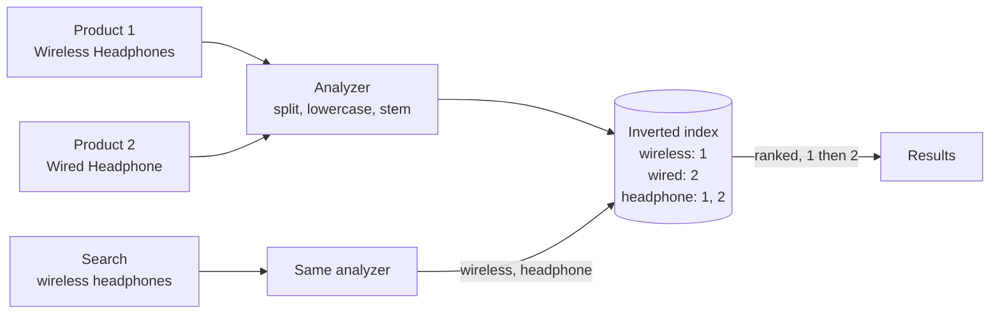

# Full Text Search

> Full text search finds documents by the words inside them and ranks the best matches first. It builds an inverted index ahead of time, so a search never has to scan every row.

## How it works

The naive version is `WHERE name LIKE '%running shoes%'`. A normal index can't help with a wildcard at the start, so the database reads every row. It's also dumb: no ranking, and it misses a product called "Shoes for running".

A search engine flips the data around with an inverted index: a map from each word to the list of documents that contain it, like the index at the back of a book. Looking up a word is one jump, however many documents you have.

Text goes through the same analysis on the way in and on every query:

- **Tokenize.** Split text into words. "Wireless Headphones, Black" becomes three tokens.
- **Normalize.** Lowercase everything and strip accents.
- **Stem.** Cut words down to a root, so "running" and "runs" both become "run".
- **Drop stop words.** Optionally skip words like "the" and "a" that match nearly everything.

To rank matches, engines score each one, usually with a formula called BM25. A document scores higher when it contains the search words more often, when those words are rare across all documents, and when the matching field is short.

Elasticsearch, OpenSearch, and Solr are all built on the Lucene library. Postgres has decent full text search built in, which is plenty for a smaller app.

Watch out: the search index is a second copy of your data, not the source of truth. Keep the database as the real record, sync changes to search through a queue or change data capture, and expect a short delay before edits show up.

## Example

An online store has 2 million products. The search box runs `LIKE '%wireless headphones%'`. It takes 1.8 seconds, misses "Headphones, wireless, over ear", and returns matches in no useful order.

The team indexes products in Elasticsearch, synced from Postgres through a queue. Now the query "wireless headphones" goes through the same analyzer as the products, set up to lowercase words and strip plurals, and becomes two terms: wireless and headphone. Elasticsearch looks up both terms in the inverted index. Products that contain both rank above products with one, and a match in a short title beats a passing mention in a long description. Results come back in about 30 ms.

When a product's name changes, search shows the new name a second or two later. For a store, that's fine.

## Picture it

Products and searches go through the same analyzer, so they meet as identical terms. The index maps each term to products, and ranking puts product 1, which matches both words, above product 2.

## Related

[Database Indexing](../07-databases/database-indexing.md) · [Change Data Capture](../09-data-at-scale/change-data-capture.md) · [Eventual Consistency](../10-distributed-systems/eventual-consistency.md) · [Storage Engines](storage-engines.md) · [Vector Search](vector-search.md)

---

[← Object Storage](object-storage.md) · [All concepts](../../README.md) · [Vector Search →](vector-search.md)
