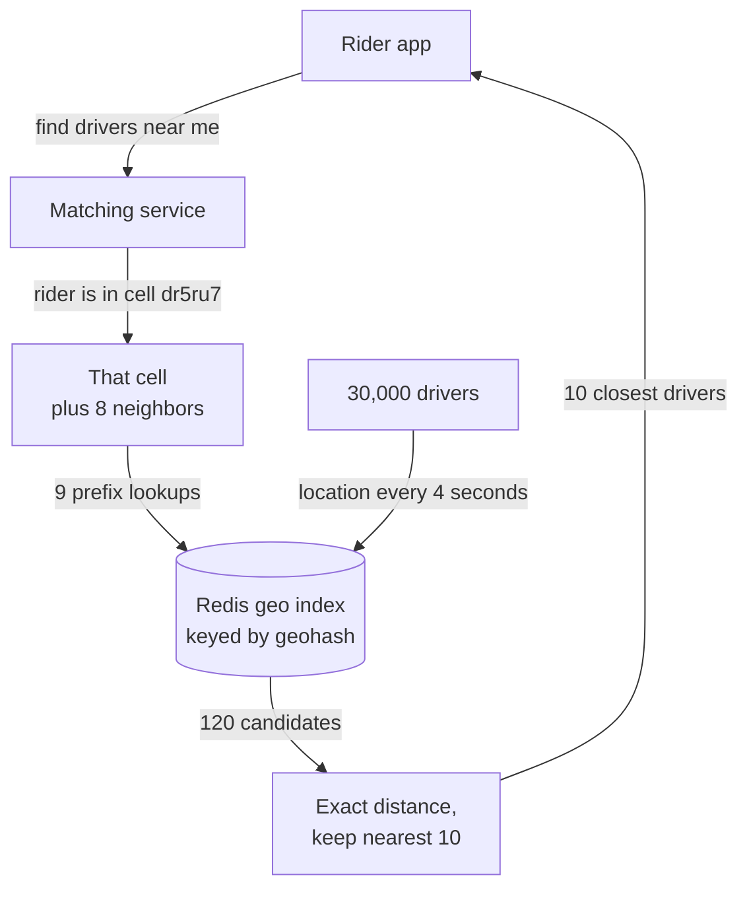

# Geospatial Indexing

> A geospatial index splits the map into cells, so a database can answer "what's near this point?" by checking a few nearby cells instead of measuring the distance to everything.

## How it works

A location is two numbers, latitude and longitude. A normal index sorts by one of them. Ask for drivers within 1 km, and it can narrow things down by latitude, but that still leaves a thin band that wraps around the whole planet.

Geospatial indexes fix this by cutting the map into cells:

- **Geohash.** Interleave the bits of latitude and longitude and write them as a short string like `dr5ru7`. Nearby points usually share a prefix, and each extra character shrinks the cell. Six characters is a cell about 1.2 km by 0.6 km at the equator. Since it's just a string, a plain B tree index can search it by prefix.
- **Quadtree.** Split the map into 4 squares, and keep splitting any square that holds too many points. Downtown gets tiny cells, the ocean gets huge ones.
- **Hexagons and spheres.** Uber's H3 uses hexagons, and Google's S2 uses cells drawn on a sphere. Same idea, better shaped cells.
- **R tree.** Groups nearby shapes into nested boxes. PostGIS uses one for shapes like delivery zones.

A query then has two steps. Find candidate points in the right cells, then compute the exact distance for just those and sort.

The catch: two points 10 meters apart can sit on opposite sides of a cell border and share no prefix at all. Always search the cell plus its 8 neighbors, or you'll miss the closest driver.

## Example

A ride sharing app has 30,000 active drivers in a city, each sending a location every 4 seconds. That's 7,500 updates a second. A rider taps "Request" and wants the 10 nearest drivers.

Measuring the distance to all 30,000 drivers works, but every single request touches every driver. Instead, the matching service keeps driver locations in Redis, which indexes them by geohash under the hood:

```
GEOADD drivers -73.9857 40.7484 driver:812
GEOSEARCH drivers FROMLONLAT -73.9855 40.7580 BYRADIUS 500 m ASC COUNT 10
```

Each location update is one `GEOADD` that overwrites the driver's old position. For a request, Redis checks the rider's cell and its neighbors, finds about 120 candidates, measures only those, and returns the 10 closest in about a millisecond.

## Picture it



Drivers keep the index fresh with a steady stream of updates. A rider's request turns into 9 cell lookups, and only the few drivers inside those cells get an exact distance check.

## Related

[Database Indexing](../07-databases/database-indexing.md) · [Hot Spots](../09-data-at-scale/hot-spots.md) · [Sharding](../09-data-at-scale/sharding.md) · [Caching](../06-caching/caching.md)

---

[← HyperLogLog](hyperloglog.md) · [All concepts](../../README.md) · [OLTP vs OLAP →](oltp-vs-olap.md)
