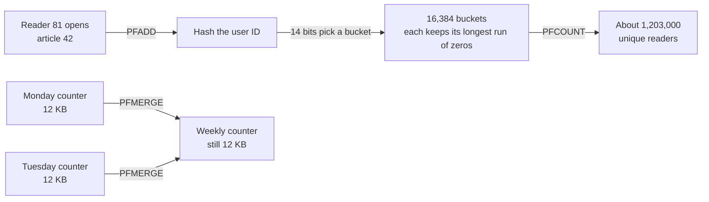

# HyperLogLog

> HyperLogLog estimates how many unique things you've seen, like daily visitors, in a few kilobytes of memory no matter how many there are. You give up an exact answer and get one that's typically off by less than 1 percent.

## How it works

Counting unique things exactly means remembering everything you've seen. Ten million visitors means storing ten million IDs, just to answer "have I seen this one before?" HyperLogLog trades a little accuracy for a small, fixed amount of memory.

The trick is a game of coin flips. Hash each item into a random looking string of bits. A hash that starts with 10 zeros turns up about once in 1,024 tries, so if you've seen one, you've probably seen around a thousand different items. The same item always hashes the same way, so repeat visits change nothing.

One longest run is a noisy guess, so the hashes get split across buckets. Redis uses 16,384 of them, and each one stores only the longest run of zeros it has seen, in 6 bits. That's at most 12 KB per counter, whether it has counted a million items or a billion. Combining all the buckets gives an estimate with a standard error of 0.81 percent: count a million visitors and you're typically off by about 8,000.

In Redis it's three commands:

- **PFADD.** Add an item to a counter.
- **PFCOUNT.** Get the estimated number of unique items.
- **PFMERGE.** Combine several counters into one that counts their union.

Merging is the superpower. Keep the larger value of each bucket, and you get exactly the counter you would have built from both streams together. Seven daily counters become a weekly one, and people who came back on Tuesday aren't counted twice.

The catch: it only counts. It can't tell you whether a given user was counted, and it can't remove anyone. Intersections are the trap. "Read both articles" worked out as A plus B minus the union carries the error of the big numbers, so a small overlap can come out wildly wrong, even negative.

## Example

A news site wants unique readers per article per day across 5,000 articles. The first version keeps a Redis set of user IDs for each article. On a big news day, the top stories hold millions of IDs each, and the sets eat several gigabytes of memory.

They switch to one HyperLogLog per article per day:

```
PFADD readers:a42:2025-06-03 user:81
PFCOUNT readers:a42:2025-06-03
PFMERGE readers:a42:week23 readers:a42:2025-06-02 readers:a42:2025-06-03
```

Memory drops to at most 12 KB per article, about 60 MB for the day, and far less in practice, because Redis stores small counters in a compact sparse form. The dashboard shows 1,203,000 readers instead of the exact 1,198,412, and nobody in the newsroom can tell. Weekly numbers come from merging the seven daily counters.

## Picture it



Every visit only touches one small bucket, and a repeat visit hashes to the same place, so it changes nothing. Merging keeps the bigger value per bucket, which is why the weekly counter costs no more than a daily one.

## Related

[Bloom Filters](bloom-filters.md) · [Back of the Envelope Math](../01-performance/back-of-the-envelope-math.md) · [Metrics](../18-observability/metrics.md) · [OLTP vs OLAP](oltp-vs-olap.md)

---

[← Bloom Filters](bloom-filters.md) · [All concepts](../../README.md) · [Geospatial Indexing →](geospatial-indexing.md)
