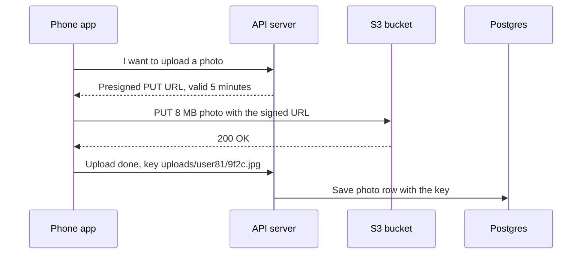

# Object Storage

> Object storage, like Amazon S3, keeps files of any size under a key inside a bucket. It's cheap, practically bottomless, and very durable, but it is not a disk you can edit in place.

## How it works

You create a bucket, `PUT` a file under a key like `photos/2025/cat.jpg`, and later `GET` it back by that key. That's most of the API. Amazon S3, Google Cloud Storage, Azure Blob Storage, and Cloudflare R2 all work this way.

It's cheap and huge. S3's standard tier costs about 2 cents per GB per month, there's no disk to size, and AWS designs it for 11 nines of durability by storing each object redundantly across at least 3 separate data centers.

A regular S3 bucket is not a filesystem, though:

- **No folders.** The slashes in `photos/2025/cat.jpg` are just characters in the key. The console draws folders to be friendly.
- **No edits in place.** You can't append to an object or change byte 500. You upload a whole new version.
- **No real rename.** Renaming is a copy plus a delete, which hurts for big files.
- **Slow per request.** Each call takes tens of milliseconds, so it's for files, not for lots of tiny database style reads.

To let users upload or download directly, your server makes a presigned URL: a link signed with your credentials that allows one kind of request, like a `PUT`, on one key until it expires, usually a few minutes later. The bytes travel between the user and the bucket, never through your servers.

The catch: a bucket set to public is readable by anyone who finds it, and leaky buckets have exposed a lot of private data over the years. Keep buckets private and hand out presigned URLs.

## Example

A photo sharing app lets users post 8 MB photos. At first, the phone sends each photo to the API server, which forwards it to S3. The API servers spend their memory and bandwidth relaying bytes, and one slow upload on a train ties up a worker for 30 seconds.

The fix is to get the API out of the way. The app asks for an upload, the API replies with a presigned URL valid for 5 minutes, and the phone sends the photo straight to S3. With most of the signing parameters cut for space, the request looks like this:

```http
PUT /uploads/user81/9f2c.jpg?X-Amz-Expires=300&X-Amz-Signature=3b1f HTTP/1.1
Host: photo-app-uploads.s3.amazonaws.com
Content-Type: image/jpeg
```

When the upload finishes, the app tells the API, which saves the key in Postgres. The API servers now handle only small JSON requests, and S3 does the heavy lifting.

## Picture it



Look at who carries the 8 MB. The API only signs a permission slip and records the key, and the photo itself goes from the phone straight into the bucket.

## Related

[CDN](../03-traffic/cdn.md) · [Backups](../21-disaster-recovery/backups.md) · [Encryption at Rest](../16-identity-and-encryption/encryption-at-rest.md) · [IAM](../16-identity-and-encryption/iam.md)
