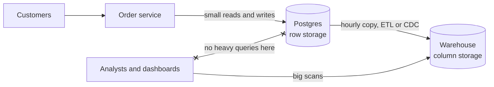

# OLTP vs OLAP

> OLTP is the day job of your database, millions of tiny reads and writes for live users. OLAP is analytics, a few huge queries over years of history, and it wants a different kind of database.

## How it works

OLTP stands for online transaction processing: place an order, update a status, fetch one user. Each query touches a handful of rows by key and has to finish in milliseconds. OLAP, online analytical processing, asks things like "revenue per city per week for two years". One query reads millions of rows but only a few columns, and nobody minds if it takes 5 seconds.

| | OLTP | OLAP |
|---|---|---|
| Typical query | Fetch or update one order | Sum a year of orders |
| Rows per query | A few | Millions |
| Layout on disk | Row by row | Column by column |
| Examples | Postgres, MySQL | Snowflake, BigQuery, ClickHouse |

Layout is the big difference. A row store keeps each row's columns together, so fetching one whole order is one read. A column store keeps each column together, so "sum of `total`" reads just that column and skips the other 39. Values in one column look alike, so they also compress very well.

That's why companies copy data out of production into a warehouse, hourly or nightly, with ETL jobs (extract, transform, load) or change data capture. Analysts get a store built for scans, and live users stay fast. The warehouse can also combine sources, like orders, ad spend, and support tickets.

The catch: the "quick query" an analyst runs on the production primary. It scans the biggest tables, pushes hot data out of memory, and slows checkout for everyone. A read replica helps, but it's still a row store, so the query stays slow.

## Example

A food delivery app's product manager wants average delivery time per city per hour for the last 90 days. They run it on production Postgres at noon.

The query scans 60 million orders, reading all 40 columns of every row to use 3 of them. It runs for 3 minutes, keeps the disk busy the whole time, and checkout latency jumps from 80 ms to 2 seconds in the middle of the lunch rush.

The fix: an hourly job copies new orders into BigQuery. The same query there reads only `city`, `created_at`, and `delivery_minutes`, finishes in about 4 seconds, and production never notices. The data is up to an hour old, which is fine for a chart about the last 90 days.

## Picture it

Live traffic and analytics never hit the same database. Postgres handles orders row by row, the warehouse handles scans column by column, and the copy job in between is the price of keeping both fast.

## Related

[Storage Engines](storage-engines.md) · [Materialized Views](../07-databases/materialized-views.md) · [Change Data Capture](../09-data-at-scale/change-data-capture.md) · [Batch vs Stream Processing](../13-messaging/batch-vs-stream-processing.md) · [Read Replicas](../09-data-at-scale/read-replicas.md)
