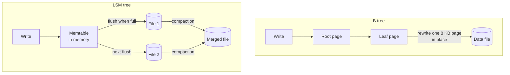

# Storage Engines

> A storage engine is the part of a database that decides how bytes sit on disk. B trees favor fast reads, LSM trees favor fast writes, and that one choice shapes everything above it.

## How it works

Two designs cover most databases.

A **B tree** stores data in fixed size pages, 8 KB in Postgres and 16 KB in MySQL's InnoDB, arranged as a sorted tree. A read walks from the root to the right page in 3 or 4 hops. A write finds the page that holds the row and updates it in place. Reads are fast and predictable, but writes land at random spots all over the disk. MySQL's InnoDB and SQLite store whole tables as B trees, and Postgres uses them for its indexes.

An **LSM tree** (log structured merge tree) never updates in place. New writes go into a sorted buffer in memory called a memtable. When it fills up, it's flushed to disk as a new sorted file that never changes. Writing is fast because it's always sequential. Reading is slower, since a key could be in memory or in any of several files, so the engine checks the newest first and uses Bloom filters to skip files. Cassandra, RocksDB, and ScyllaDB work this way.

Compaction keeps the files in check. In the background, the engine merges small files into bigger ones, keeping only the newest value of each key. It costs disk bandwidth and CPU, and when it falls behind, files pile up and reads slow down.

Rule of thumb: read heavy, B tree. A firehose of writes, LSM tree.

The catch: in an LSM tree, a delete is just another write, a marker called a tombstone. Disk space comes back only after compaction, and a table where you delete millions of rows can make reads wade through tombstones.

## Example

A multiplayer game records every match event: kills, item pickups, deaths. That's 50,000 writes a second at peak, and almost nothing reads them except a nightly stats job.

On Postgres, each insert updated the table and two B tree indexes, touching pages scattered across the disk. The database kept up, barely, and replicas fell behind every evening at peak.

The team moved match events to Cassandra, an LSM store. Writes now collect in memory and leave as large sequential files, and the same hardware handles the load with room to spare. Compaction runs in the background with its own slice of disk bandwidth.

Player profiles stayed in Postgres. They're read on every login, updated a few times a day, and need fast, predictable lookups. That's B tree territory.

## Picture it

The B tree finds the exact page and rewrites it, which keeps reads simple. The LSM tree just buffers and appends, then tidies up later with compaction, which makes writes cheap and means a read may check several files.

## Related

[Write Ahead Log](write-ahead-log.md) · [Bloom Filters](bloom-filters.md) · [OLTP vs OLAP](oltp-vs-olap.md) · [Database Indexing](../07-databases/database-indexing.md) · [SQL vs NoSQL](../07-databases/sql-vs-nosql.md)

---

[← Schema Versioning](../07-databases/schema-versioning.md) · [All concepts](../../README.md) · [Write Ahead Log →](write-ahead-log.md)
