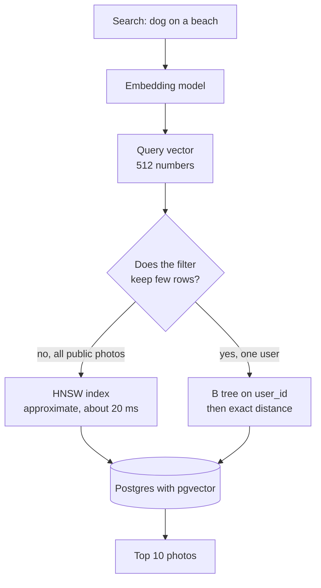

# Vector Search

> Vector search finds things by meaning instead of keywords. It turns text or images into lists of numbers and looks for the closest ones, usually with an approximate index that trades a little accuracy for a lot of speed.



## How it works

An embedding model turns a piece of text or an image into a vector, a list of numbers. OpenAI's `text-embedding-3-small` returns 1,536 of them. The model is trained so that similar meanings land close together: a photo of a puppy on sand sits near the words "dog on a beach", with no keyword in common.

Search becomes geometry. Turn the query into a vector, then find the stored vectors nearest to it, often by cosine distance, which compares the direction two vectors point. Exact search compares the query with every vector. Fine for 100,000 rows, far too slow for 100 million.

So most systems use an approximate nearest neighbor index, which checks a small slice of the data and accepts missing a few matches:

- **HNSW.** A graph where each vector links to its near neighbors, stacked in layers from sparse to dense. A search starts at the top and hops closer at every step. Fast and accurate, but slow to build and hungry for memory.
- **IVF.** Vectors are grouped into clusters ahead of time, and a search scans only the few clusters nearest the query. Faster to build and smaller, but less accurate at the same speed.

Recall is the share of the true top 10 you actually get back. Each index has a knob, like `hnsw.ef_search` or `ivfflat.probes` in pgvector, that trades speed for recall.

pgvector adds all of this to Postgres, so vectors sit next to the rows they describe. Dedicated vector databases like Pinecone, Qdrant, and Milvus are built for bigger collections and heavier search traffic.

The catch: filters. With an approximate index, Postgres walks the index first and applies your `WHERE` afterward. If HNSW hands back 40 candidates and the filter keeps 10 percent of rows, you get about 4 results when you asked for 10.

## Example

A photo sharing app lets people search photos by description, like "dog on a beach". It keeps 80 million photos in Postgres, each with a 512 number embedding, under one HNSW index. Searching all public photos takes about 20 ms.

Searching one user's photos returns nothing. The query asks for `user_id = 42` and the 10 closest vectors. HNSW returns the 40 closest photos out of all 80 million, none of them belong to user 42, and the filter throws all 40 away.

User 42 has only 3,000 photos, so this query shouldn't use the vector index at all. With a B tree index on `user_id`, Postgres can fetch those 3,000 rows first and compare each one exactly, in a few milliseconds, with nothing missed. For broad filters, like public photos from 2024, you can turn on pgvector's iterative scans, which keep walking the index until enough rows pass.

```sql
CREATE INDEX ON photos (user_id);

SELECT id FROM photos
WHERE user_id = 42
ORDER BY embedding <=> $1
LIMIT 10;
```

## Picture it



The query becomes a vector first. A broad search goes through the approximate index, while a narrow filter fetches the few matching rows and compares them exactly, so it never comes back empty.

## Related

[Full Text Search](full-text-search.md) · [Database Indexing](../07-databases/database-indexing.md) · [Geospatial Indexing](geospatial-indexing.md) · [Query Optimization](../07-databases/query-optimization.md)

---

[← Full Text Search](full-text-search.md) · [All concepts](../../README.md) · [Bloom Filters →](bloom-filters.md)
