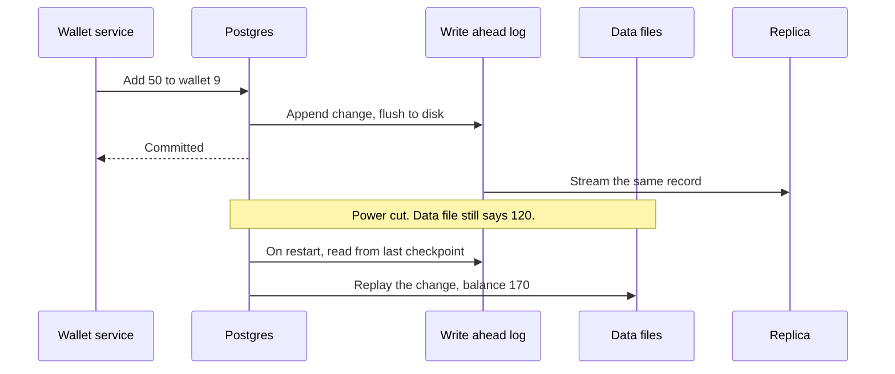

# Write Ahead Log

> A write ahead log is an append only file where a database records every change before applying it. If the server crashes, the database replays the log and every committed change comes back.

## How it works

Changing data in place is slow and fragile. One transaction might touch 12 pages scattered across the disk, and a power cut halfway through leaves some of them written and some not.

So the database does something cheaper first. It appends a short record of the change, like "wallet 9: balance 120 to 170", to the end of the log and forces it to disk with `fsync`. Appending is sequential and fast. Only then does it tell the client "committed". The real data pages get updated in memory and written to disk later, in batches.

Recovery after a crash is simple. On restart, the database finds the last checkpoint, a point where all earlier changes were known to be safely in the data files, and replays every log record after it. Committed changes come back. Changes from transactions that never committed never become visible.

The same log turns out to be useful for more than crashes:

- **Replication.** Postgres streams its log to replicas, which replay it and stay in sync.
- **Point in time recovery.** Keep old log files next to a backup, and you can rebuild the database as it was at 14:32 yesterday.
- **Change data capture.** Tools like Debezium read the log to stream every change into Kafka.

Postgres calls it the WAL, MySQL's InnoDB calls it the redo log, and SQLite has a WAL mode.

The catch: Postgres can give each reader a replication slot, a bookmark that stops it from deleting log files that reader hasn't read yet. A replica with a slot that died weeks ago, or a forgotten slot, makes it keep every log file until the disk fills up.

## Example

A wallet app. A user tops up $50, so wallet 9 goes from $120 to $170.

Postgres appends the change to the WAL and flushes it to disk, which takes about 2 ms. It replies "committed", and the app shows $170. The data file on disk still says $120, because that page only lives in memory for now.

One second later, the server loses power.

On restart, Postgres starts from the last checkpoint and replays the log. It finds the top up record and applies it. Wallet 9 says $170 again, and the user never knows anything happened.

Meanwhile, a replica in another zone had already received that same log record over the network and applied it, so it says $170 too.

## Picture it

The only thing that has to reach the disk before the reply is one small log record. The data file catches up later or during recovery, and the replica reads the very same stream.

## Related

[ACID Transactions](../07-databases/acid-transactions.md) · [Storage Engines](storage-engines.md) · [Replication](../09-data-at-scale/replication.md) · [Change Data Capture](../09-data-at-scale/change-data-capture.md) · [Backups](../21-disaster-recovery/backups.md)
