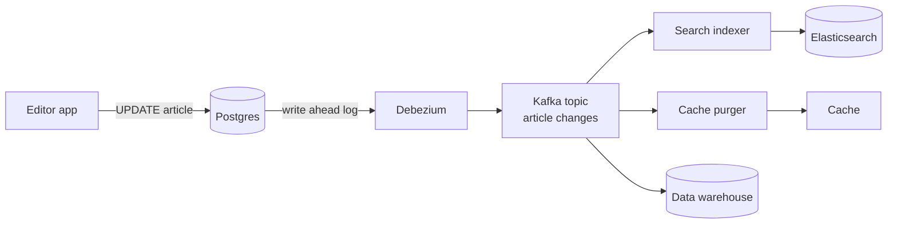

# Change Data Capture

> Change data capture reads your database's own change log and turns every insert, update, and delete into an event. Search indexes, caches, and analytics stay in sync without your app writing to each one.

## How it works

Every serious database keeps a log of changes for crash recovery and replication. Postgres has the write ahead log, MySQL has the binlog. A CDC tool connects like a replica would, reads that log, and publishes each change as an event, usually to Kafka. Debezium is the best known open source one.

Each event says what changed: the table, the operation, the row before, the row after, and its position in the log. Downstream systems, like a search index, a cache, a data warehouse, or another team's service, each read the stream at their own pace.

Why not have the app write to the database and then to the search index? That's a dual write, and it breaks. The second write fails after the first succeeded, or two requests race and land in different orders. The two systems drift apart, and nobody notices for weeks. With CDC, the database is the single source of truth, and everything else follows its log in commit order.

CDC also catches changes the app never sees: a migration, a batch job, someone fixing a row by hand in a SQL console.

Watch out: Postgres holds on to its log until the reader confirms it. A stalled CDC connector keeps its replication slot open, and unread log piles up on the leader's disk. If the connector is down all weekend, the disk can fill and take the database with it. Alert on connector lag long before the disk does.

## Example

A news site stores articles in Postgres and powers search with Elasticsearch. The editor app used to save to Postgres, then call Elasticsearch. One afternoon Elasticsearch was slow, the second call timed out, and a corrected headline stayed wrong in search for two days.

Now Debezium reads the Postgres log and publishes every change to a Kafka topic. A small indexer service reads the topic and updates Elasticsearch. A second consumer clears the article from the cache. If Elasticsearch goes down for 10 minutes, the indexer picks up where it left off. A simplified event, with the table set to `REPLICA IDENTITY FULL` so Postgres logs the old row too:

```json
{
  "op": "u",
  "source": { "table": "articles", "lsn": 48213992 },
  "before": { "id": 812, "headline": "Mayor resigns" },
  "after":  { "id": 812, "headline": "Mayor denies resignation" }
}
```

## Picture it



The editor app only ever writes to Postgres. Debezium reads the database log as it grows and turns each change into an event, and every system on the right consumes those events at its own pace.

## Related

[Write Ahead Log](../08-storage/write-ahead-log.md) · [Outbox Pattern](../13-messaging/outbox-pattern.md) · [Event Streaming](../13-messaging/event-streaming.md) · [Cache Invalidation](../06-caching/cache-invalidation.md) · [Replication](replication.md)
