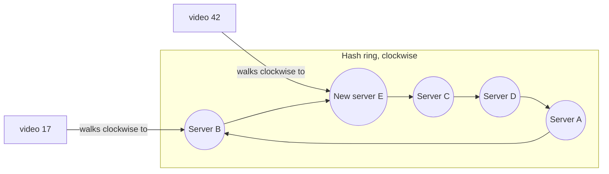

# Consistent Hashing

> Consistent hashing puts servers and keys on the same circle, and each key belongs to the next server along it. Add or remove a server and only a small slice of keys moves, instead of nearly all of them.

## How it works

The naive way to pick a server is `hash(key) % N`. It's even and simple, until N changes. Go from 4 cache servers to 5 and about 80% of keys map somewhere new. For a cache, that means 80% misses at once and a flood of traffic to the database behind it.

Consistent hashing uses a ring instead. Take the range of hash values, say 0 to about 4 billion, and bend it into a circle. Hash each server's name to a point on the circle. Hash each key too, then walk clockwise until you hit a server. That server owns the key.

Now add a fifth server. It lands at one point on the ring and takes over only the keys between it and the server before it. Everything else stays put. With 5 servers, roughly 1 key in 5 moves, and all of them move to the new server. Remove a server and only its keys shift, to the next one along.

With one point per server, the ring is lumpy. By bad luck, one server might own 40% of the circle. The fix is virtual nodes: each physical server gets many points scattered around the ring, often 100 or more. Load evens out, and when a server leaves, its keys spread across all the others instead of piling onto one neighbor. A bigger machine can simply get more points.

Cassandra uses this, and so do many Memcached client libraries.

Watch out: consistent hashing decides where keys go, not how busy they are. If one key gets half the traffic, it still lands on one server.

## Example

A video streaming site caches video details, like titles and thumbnails, on 4 Memcached servers. The app picks a server with `hash(video_id) % 4`, and the hit rate is 95%.

Friday night, traffic spikes and someone adds a fifth server. Now `% 5` sends about 80% of keys to a server that doesn't have them cached. Misses jump from 5% to over 80%, the database behind the cache gets about 16 times its usual reads, and the home page times out.

With consistent hashing and 200 virtual nodes per server, the fifth server takes about 20% of the keys. The hit rate dips to around 76%, then climbs back as the new server fills up. Nobody gets paged.

## Picture it

Each key belongs to the first server clockwise from it. New server E lands between B and C, so it only takes keys from that gap, like video 42, which used to belong to C. Keys owned by A, B, and D never move.

## Related

[Sharding](sharding.md) · [Hot Spots](hot-spots.md) · [Caching](../06-caching/caching.md) · [Cache Stampede](../06-caching/cache-stampede.md) · [Load Balancing](../03-traffic/load-balancing.md)

---

[← Sharding](sharding.md) · [All concepts](../../README.md) · [Hot Spots →](hot-spots.md)
