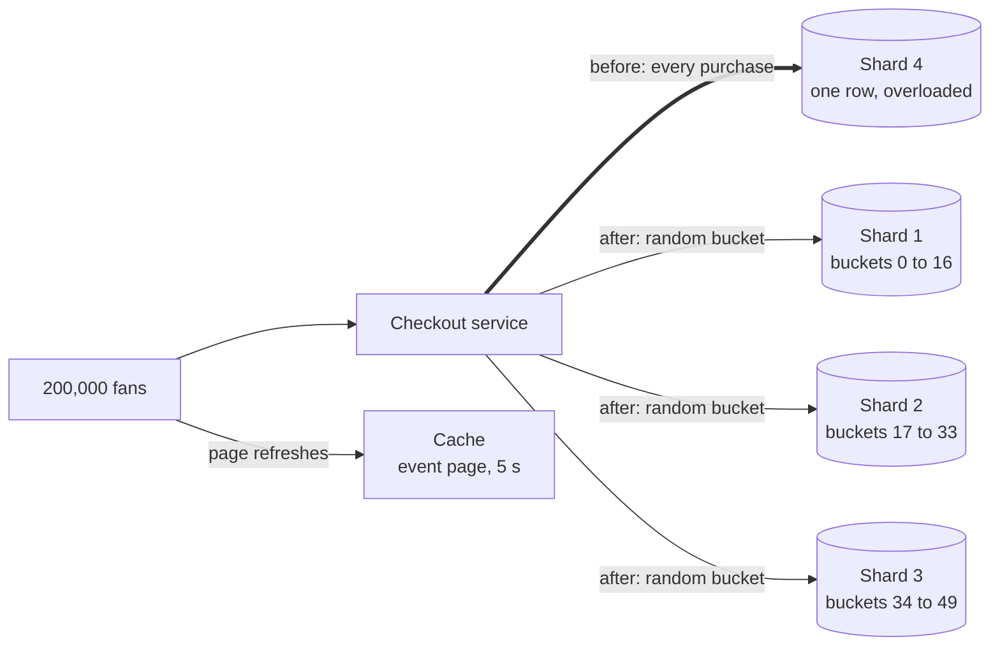

# Hot Spots

> A hot spot is one key, shard, or server getting far more traffic than the rest. Spreading your data evenly doesn't help when everyone wants the same piece of it.

## How it works

Hashing spreads keys evenly, not traffic. If 1 key out of 10 million gets 30% of all requests, the shard or cache node holding it does that 30% of the work alone, on top of its normal share. Adding servers changes nothing, because that key still lives in one place.

Hot spots come in two flavors. Hot keys are single items: a celebrity's profile, a viral product, a ticket sale everyone joins at 10:00 sharp. Hot ranges come from a bad partition key: partition by timestamp, and every new write lands on the newest partition.

Fixes, roughly in the order to try them:

- **Cache it.** Hot reads are the easy case. Put the item in a cache, or in memory on each app server for a few seconds, so most reads never reach the database.
- **Split the key.** For hot writes, spread one logical key over several real ones. A like counter becomes `likes:123:0` through `likes:123:9`, each write picks one at random, and reads add up all ten.
- **Copy the hot item.** Keep extra copies of just that key on several nodes and spread its reads among them.
- **Fix the key.** For hot ranges, put a hash or a random prefix in front of the key so new writes scatter instead of piling up.

The catch: hot spots hide in averages. Cluster CPU says 20% while one shard sits at 100%. Track your busiest keys and busiest shards on their own, so you spot the one row getting hammered before it takes its shard down.

## Example

A ticketing site puts a stadium show on sale at 10:00. There are 50,000 tickets, stored as one inventory row: `event 9001, remaining 50000`.

Within a minute, 200,000 fans tap Buy. Every purchase subtracts one from that same row, so they all wait in line for the same row lock. The shard holding it is buried under the queue, the other 11 shards sit nearly idle, and checkouts time out.

The fix splits the inventory into 50 rows of 1,000 tickets each, `9001:0` through `9001:49`, spread across several shards. Each purchase grabs a random row that still has tickets, so 50 purchases run in parallel instead of one. The event page, which every fan refreshes nonstop, gets cached for 5 seconds, so those reads never touch the database.

## Picture it

The thick arrow is the problem: every purchase lands on one row on one shard. After the fix, purchases scatter across 50 bucket rows on several shards, and the page everyone keeps refreshing comes from the cache.

## Related

[Sharding](sharding.md) · [Consistent Hashing](consistent-hashing.md) · [Caching](../06-caching/caching.md) · [Partitioning](partitioning.md) · [Zipf's Law](../23-laws/zipfs-law.md)

---

[← Consistent Hashing](consistent-hashing.md) · [All concepts](../../README.md) · [Change Data Capture →](change-data-capture.md)
