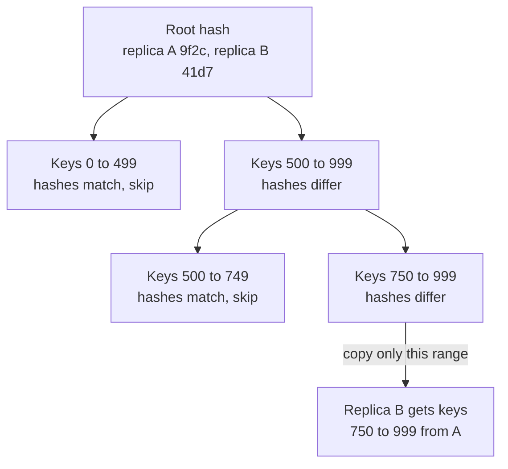

# Merkle Trees

> A Merkle tree is a tree of hashes where each parent is the hash of its children, so one root hash stands for all the data. Two machines compare roots, then walk down only where they differ.

## How it works

Two replicas each hold a million keys, and you suspect they disagree somewhere. Shipping every key across the network to compare is slow and expensive. A Merkle tree finds the difference by trading a few dozen hashes.

Build it from the bottom. Hash each key with its value, or each small range of keys. Those are the leaves. Hash each pair of leaves together into a parent, then pairs of parents, until one hash is left at the top: the root. Change one byte anywhere and the root changes, because every hash above that byte changes with it.

To compare two replicas, swap roots first. Same root, same data, done. Different roots, compare the two children and follow only the side that differs. With a million leaves the tree is 20 levels deep, so you can corner one bad key in about 20 rounds instead of shipping everything.

You'll find them in three famous places:

- **Dynamo style databases.** Amazon's Dynamo and Cassandra's repair compare Merkle trees between replicas and copy only the ranges that differ. This background fixing is called anti entropy.
- **Git.** Every file, folder, and commit is named by the hash of its contents, so one commit hash vouches for the whole project.
- **Certificate Transparency.** Public logs of TLS certificates are Merkle trees. Anyone can check that a certificate is in the log with a short proof, and that nobody quietly rewrote the log's history.

Watch out: building the tree means reading and hashing all the data, so repair is heavy and easy to put off. Cassandra's docs say to repair often enough that no unrepaired data outlives the gc grace period, the time a delete marker is kept, 10 days by default. Skip it, and deleted rows can come back from the dead.

## Example

A ride sharing app keeps trip history in a Cassandra style cluster, with 3 replicas of every row. One replica drops off the network for 90 seconds. Hints, which normally replay missed writes later, are best effort, and a few hundred writes never make it across.

Comparing the data directly would mean shipping 200 GB from each replica. Instead, repair builds a Merkle tree over the same key range on each one, with about a million leaves covering 200 KB each. The roots differ. At every level, matching branches are skipped. Twenty levels down, 300 leaves differ, and only those ranges, about 60 MB, get copied to the replica that fell behind.

Riders never noticed, because every read asked 2 of the 3 replicas and at least one had the newest data. The repair makes sure the third copy is right before the next failure needs it.

## Picture it

The roots disagree, so the replicas compare one level down. Half the tree matches and is never looked at again. Following only the branch that differs leads straight to the one range worth copying.

## Related

[Replication](replication.md) · [Eventual Consistency](../10-distributed-systems/eventual-consistency.md) · [Gossip Protocol](../10-distributed-systems/gossip-protocol.md) · [Quorum](../10-distributed-systems/quorum.md) · [Consistent Hashing](consistent-hashing.md)

---

[← Read Replicas](read-replicas.md) · [All concepts](../../README.md) · [Partitioning →](partitioning.md)
