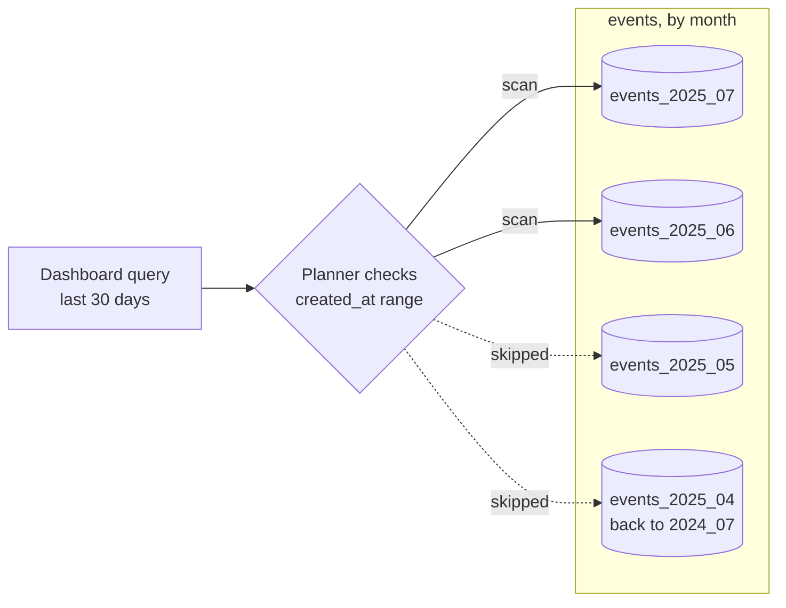

# Partitioning

> Partitioning splits one big table into smaller pieces by a rule, like one piece per month. Queries only touch the pieces they need, and old data goes away in one cheap step.



## How it works

You pick a partition key and a rule that maps every row to exactly one piece. The three common rules:

| Rule | How rows are placed | Good for |
|---|---|---|
| Range | `created_at` in March goes to the March piece | Logs, events, "last 7 days" queries |
| Hash | A hash of `user_id` picks one of 16 pieces | Spreading rows evenly |
| List | `country` in (US, CA) goes to the North America piece | A few known groups |

This can all happen inside one database server. Postgres lets you declare a partitioned table, and your app keeps querying `events` as if it were one table. Underneath, there are separate smaller tables, each with its own indexes.

The big win is partition pruning. When a query filters on the partition key, the database's query planner skips every piece that can't match. A query for the last 7 days reads one or two monthly pieces, not five years of them. Deleting old data becomes dropping a whole partition, which takes milliseconds, instead of a `DELETE` that grinds through millions of rows.

Watch out: pruning only works when the query filters on the partition key. Partition by `created_at`, then look rows up by `customer_id`, and the database checks every single partition. You made that query slower, not faster.

When the pieces live on separate servers instead of one, it's called sharding. Same idea, a lot more pain.

## Example

A SaaS dashboard stores every tracked click in one Postgres `events` table. At 2 billion rows, the "last 30 days" chart takes 9 seconds to load, and the nightly job that deletes events older than 13 months runs for 4 hours.

The team switches to one partition per month:

```sql
CREATE TABLE events (
  account_id bigint,
  created_at timestamptz,
  payload    jsonb
) PARTITION BY RANGE (created_at);

CREATE TABLE events_2025_07 PARTITION OF events
  FOR VALUES FROM ('2025-07-01') TO ('2025-08-01');
```

Now the chart query prunes down to two partitions and returns in about 300 ms. The nightly cleanup becomes `DROP TABLE events_2024_06`, which finishes before you can blink.

## Picture it



The query asks for the last 30 days, so the planner only opens the two newest partitions. Every older month is skipped without reading a single row.

## Related

[Sharding](sharding.md) · [Database Indexing](../07-databases/database-indexing.md) · [Query Optimization](../07-databases/query-optimization.md) · [Hot Spots](hot-spots.md) · [OLTP vs OLAP](../08-storage/oltp-vs-olap.md)

---

[← Merkle Trees](merkle-trees.md) · [All concepts](../../README.md) · [Sharding →](sharding.md)
