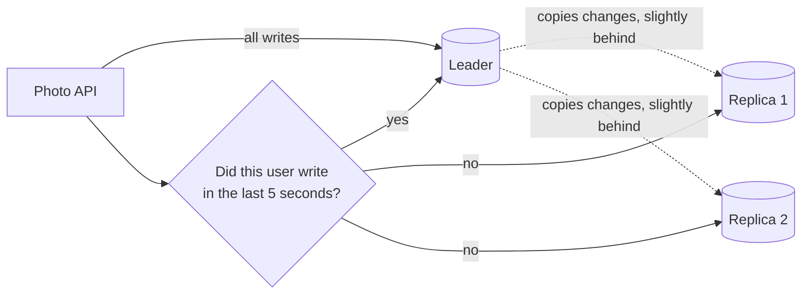

# Read Replicas

> Read replicas are copies of your database that only serve reads. Most apps read far more than they write, so moving reads to replicas takes most of the load off the main database.

## How it works

The leader still takes every write. Each replica copies the leader's changes and answers `SELECT` queries. Your app, or a proxy in front of the database, sends writes to the leader and spreads reads across the replicas. If 90% of your queries are reads, 3 replicas can take nearly all of that 90% off the leader.

The price is replica lag. Replicas usually copy changes asynchronously, so each one is a little behind. Usually that's a few milliseconds. During a big batch job or a slow network, it can be seconds or minutes. Any read from a replica might be stale.

The classic victim is read your own writes. A user saves a change, the page reloads, the read lands on a replica that hasn't caught up, and the change seems to have vanished. Common fixes:

- **Read from the leader after a write.** For a few seconds after a user writes, send that user's reads to the leader.
- **Track log positions.** Every write has a position in the leader's log. Remember the user's last one and only read from a replica that has reached it.
- **Keep money reads on the leader.** Anything where stale data costs real money, like a balance check before a payment, always goes to the leader.

The catch: replicas scale reads, not writes. Every replica still has to apply every write, so if the leader is drowning in writes, adding replicas does nothing. That's when you start looking at sharding.

## Example

A photo sharing app runs one Postgres leader and 3 replicas. A user edits the caption on a photo, taps Save, and the app reloads the photo page.

On a busy evening the replicas are 800 ms behind. The reload hits a replica, the old caption shows up, and the user edits it again. By Monday there are support tickets saying "my edits don't save", even though every edit saved fine.

The fix is a few lines in the data layer. The API records when each user last wrote, and for 5 seconds after that, their reads go to the leader:

```python
def db_for_read(session):
    if time.time() - session.last_write_at < 5:
        return leader
    return random.choice(replicas)
```

Everyone else keeps reading from replicas, so the leader barely notices.

## Picture it



Writes always go to the leader, and the replicas trail it by a moment. Reads go to a replica unless the user just wrote something. Then they go to the leader, so the user always sees their own change.

## Related

[Replication](replication.md) · [Sharding](sharding.md) · [Eventual Consistency](../10-distributed-systems/eventual-consistency.md) · [Caching](../06-caching/caching.md) · [Connection Pooling](../07-databases/connection-pooling.md)

---

[← Replication](replication.md) · [All concepts](../../README.md) · [Merkle Trees →](merkle-trees.md)
