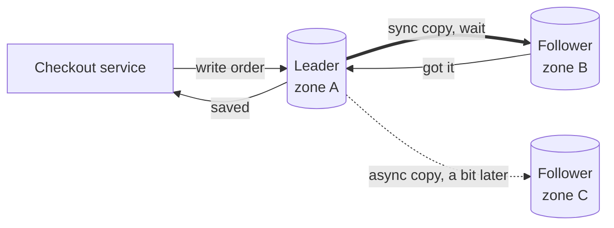

# Replication

> Replication keeps copies of the same data on several machines. If one dies, another already has everything, and you can spread reads across the copies.

## How it works

In most setups, every write lands on one node first. That node records it in its log of changes and streams the log to the other copies, called replicas. Two choices shape everything after that.

First, when do you tell the client "saved"? With synchronous replication, the leader waits until a follower confirms it has the write. A dead leader loses nothing, but every write pays a network round trip, and one slow follower stalls all writes. With asynchronous replication, the leader answers right away and ships the change a moment later. Fast, but if the leader dies, its last few writes die with it. Many setups wait for one follower and let the rest catch up on their own.

Second, who is allowed to take writes?

- **Leader and follower.** One leader takes every write, and followers copy it. Simple, and the default in Postgres and MySQL.
- **Multi leader.** Several nodes take writes, often one per region, and sync with each other. Writes are fast everywhere, but two leaders can change the same row at once, and you need a rule to settle who wins.
- **Leaderless.** The client, or a node acting for it, writes to several replicas at once and reads from several. Cassandra and Riak work this way.

Watch out: replication is not a backup. Run `DELETE FROM orders` by mistake and every replica faithfully deletes them too, within milliseconds.

## Example

An online store keeps orders in Postgres: a leader in one availability zone and two async followers in others. A zone is a separate data center in the same region, a millisecond or two away.

At 14:02 the leader's disk dies. The followers were about 300 ms behind, which happens with async at peak load. You promote one of them and the store is back in 30 seconds. But the 6 orders placed in that last 300 ms are gone, and those customers already got a confirmation email.

The fix is to wait for any one follower before confirming a write. Checkout gets about 2 ms slower. The next failover loses nothing, and if one follower goes down, the other still confirms writes.

```ini
# postgresql.conf on the leader
synchronous_commit = on
synchronous_standby_names = 'ANY 1 (replica_b, replica_c)'
```

## Picture it



The leader only tells the checkout service "saved" after the zone B follower has the order, so losing the leader loses nothing. The zone C follower catches up on its own time and may be slightly behind.

## Related

[Read Replicas](read-replicas.md) · [Failover](../21-disaster-recovery/failover.md) · [Write Ahead Log](../08-storage/write-ahead-log.md) · [Eventual Consistency](../10-distributed-systems/eventual-consistency.md) · [Backups](../21-disaster-recovery/backups.md)
