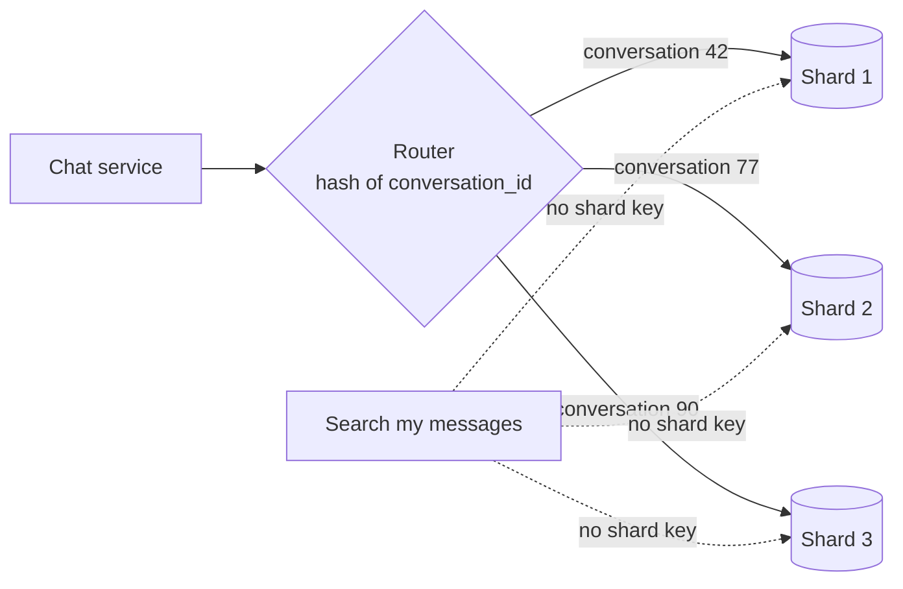

# Sharding

> Sharding splits your data across several database servers, and each one holds a slice. It's how you grow past what one machine can store or write, and you pay for it in complexity forever.

## How it works

Each server, called a shard, holds a subset of the rows. A shard key decides where each row lives: hash the key, or look up which range it falls in, and you get a shard number. Any query that includes the key goes straight to one shard. 4 shards means roughly 4 times the write capacity and storage.

Picking the shard key is the decision that sticks. A good key:

- **Spreads load evenly.** `user_id` usually does. `country` puts half your users on one shard.
- **Matches your main queries.** If most queries are "messages in conversation 42", shard by conversation so they hit one shard.
- **Keeps related rows together.** Rows you join or update in one transaction should live on the same shard.

Queries without the shard key become scatter gather: ask every shard, wait for the slowest, merge the results. Transactions across shards need two phase commit or a saga, both slow and fiddly. Unique constraints and auto increment IDs only work inside one shard.

The catch: resharding. With `hash(key) % N`, going from 4 shards to 5 moves 80% of your rows. And you have to move them while the app keeps running, write to both places during the move, then cut over without losing anything. The usual escape is many small logical shards, like 256, mapped onto a few servers. Adding a server means moving a few whole logical shards, not rehashing every row. When Notion outgrew its single Postgres database, it sharded this way, with 480 logical shards on 32 physical databases.

## Example

A chat app keeps every message in one Postgres server. At 5 TB and 20,000 writes a second, it's already the biggest machine the cloud provider sells.

The team shards by `conversation_id` across 8 servers. Opening a chat reads one conversation, so it hits one shard and stays fast. Both people in a chat read the same messages, so sharding by user would have split every conversation in two.

The pain shows up elsewhere. "Search all my messages" has no conversation ID, so it asks all 8 shards and waits for the slowest one. After a few slow weeks, the team moves search into a separate search index instead of fighting the shards.

## Picture it

Normal reads carry a conversation ID, so the router sends each one to exactly one shard. The search has no shard key, so it has to ask every shard and wait for all of them.

## Related

[Partitioning](partitioning.md) · [Consistent Hashing](consistent-hashing.md) · [Hot Spots](hot-spots.md) · [Distributed Transactions](../11-coordination/distributed-transactions.md) · [YAGNI](../24-principles/yagni.md)
