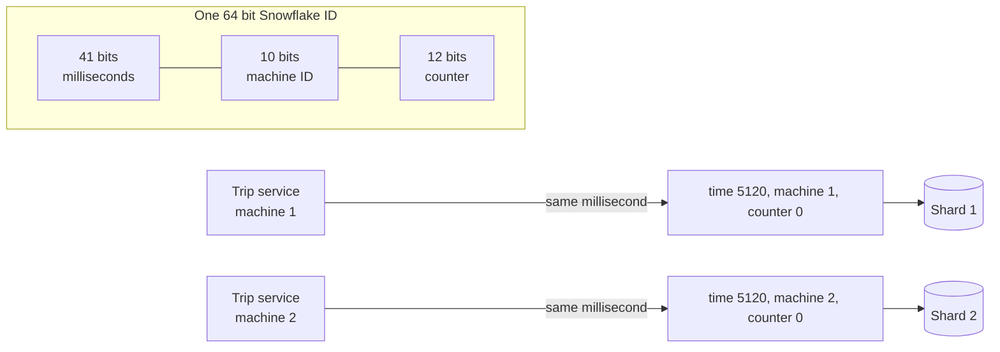

# Unique ID Generation

> Every order, message, and user needs an ID that never repeats. One database can just count, but once you have many servers, you need IDs that any machine can make without asking anyone else.

## How it works

Auto increment is the default: the database hands out 1, 2, 3. It's small and sorted. It breaks when you shard, because two shards will both hand out 1001. It also leaks business data: place an order today and another next week, and the gap tells you how many orders the store took.

| Option | Size | Sorted by time | Notes |
|---|---|---|---|
| Auto increment | 32 or 64 bits | Yes | One database decides |
| UUID v4 | 128 bits | No | Fully random |
| UUID v7 | 128 bits | Yes | Millisecond timestamp first, random after |
| Snowflake | 64 bits | Yes | Time, machine ID, and counter packed together |

Random UUIDs need no coordination and practically never collide, but they hurt databases. An index is a sorted tree, and it stays fast when new keys land at the end. Random keys land everywhere, so every insert touches a different part of the index and the memory cache stops helping. Time ordered IDs like UUID v7 or Snowflake keep inserts at the end and still need no coordination.

Twitter built Snowflake for this. A Snowflake ID packs 41 bits of milliseconds since a chosen start date, 10 bits of machine ID, and 12 bits of counter into one 64 bit number, with the top bit left at 0. Each machine can make 4,096 IDs per millisecond, and the IDs sort roughly by creation time.

The catch: time based IDs trust the clock. If a server's clock jumps backward, it can repeat an ID. Snowflake refuses to issue IDs until the clock catches up. And every machine needs a unique machine ID, or two of them will collide.

## Example

A ride sharing app splits its trips table across 4 Postgres servers, and each one keeps its own auto increment counter. Within a week, two trips get ID 88213 on different shards. The receipt service looks trips up by ID alone, and a rider in Lisbon gets a receipt for a ride in Denver.

The team switches to Snowflake style IDs. Each trip service instance gets a machine ID from its config and builds IDs locally:

```python
trip_id = (ms_since_epoch << 22) | (machine_id << 12) | sequence
```

No server has to ask another for anything, IDs never collide, and because the timestamp comes first, sorting trips by ID sorts them by time.

## Picture it



Two machines make an ID in the same millisecond without talking to each other. The machine ID bits differ, so the IDs differ, and the timestamp in front keeps them sorted by time.

## Related

[Sharding](sharding.md) · [Clock Skew](../10-distributed-systems/clock-skew.md) · [Database Indexing](../07-databases/database-indexing.md) · [Logical Clocks](../10-distributed-systems/logical-clocks.md) · [Idempotency](../14-reliability/idempotency.md)
