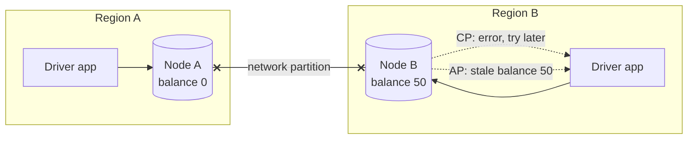

# CAP Theorem

> When the network splits a distributed database in two, each side has to choose: keep answering and risk stale data, or stop answering until it can be sure. You cannot have both.

## How it works

CAP names three properties:

- **Consistency.** Every read sees the latest write. All nodes agree.
- **Availability.** Every request to a working node gets a real answer, not an error.
- **Partition tolerance.** The system keeps going when messages between nodes are lost.

You often hear "pick two". That is misleading. On a real network, partitions happen whether you like it or not. Cables get cut, switches die, a whole cloud zone goes dark. So partition tolerance is not optional, and the real choice only shows up during a split: consistency or availability.

- **CP systems** refuse to answer on the side that might be out of date. Think etcd, or anything holding money or locks.
- **AP systems** keep answering and fix conflicts once the network heals. Think Cassandra, shopping carts, like counters.

When the network is healthy, you get both. A follow up idea called PACELC adds the everyday tradeoff: even with no partition, stronger consistency costs you latency, because nodes have to talk before they answer.

The catch: the C in CAP means "every read sees the newest write", which is formally called linearizability. It is not the C in ACID, which is about rules like "balance never goes below zero".

## Example

A ride sharing app keeps driver wallets in two regions. The link between the regions drops for two minutes. During the split, a driver cashes out $50 in Region A. A second request lands in Region B, which never heard about the cashout.

- **CP choice:** Region B says "try again in a moment". The driver is annoyed for two minutes. Nobody gets paid twice.
- **AP choice:** Region B shows the old balance and might allow a second cashout. Someone now has to claw $50 back.

For wallets, pick CP. For the like count on a post, AP is fine. Showing 1,203 likes instead of 1,204 for a minute hurts nobody.

## Picture it

The link between the regions is cut, so Node B never heard about the cashout. The two dotted arrows are the two choices it has: refuse to answer, or answer with old data.

## Related

[Network Partitions](network-partitions.md) · [Strong Consistency](strong-consistency.md) · [Eventual Consistency](eventual-consistency.md) · [Quorum](quorum.md) · [PACELC](../23-laws/pacelc.md)

---

[← Network Partitions](network-partitions.md) · [All concepts](../../README.md) · [Strong Consistency →](strong-consistency.md)
