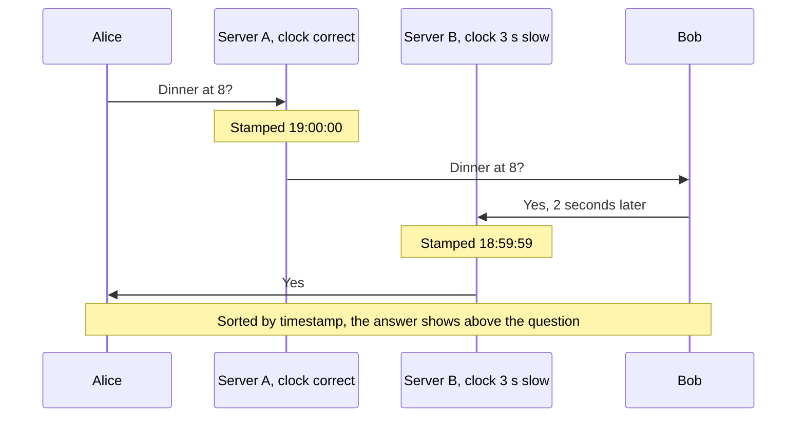

# Clock Skew

> Every server has its own clock, and no two of them agree exactly. That gap is clock skew, and it means timestamps from different machines can put events in the wrong order.

## How it works

A server keeps time with a cheap quartz crystal, and left alone it can drift by a second or more a day. NTP, the network time protocol, corrects this: each server regularly asks a time server for the right time and nudges its own clock toward it. On a good network, that keeps servers within a few milliseconds of each other. If NTP quietly breaks on one machine, there's no limit at all.

Clocks also jump. NTP can step a clock backward to fix it, and a paused and resumed VM can wake up with the wrong time. Code that measures a duration as "now minus start" with the wall clock can get a negative number.

The trouble shows up whenever you compare timestamps from two machines:

- **Ordering.** Server A logs an event at 10:00:00.120. Server B, running 60 ms slow, logs a later event at 10:00:00.080. Sort by time, and the later one comes first.
- **Last write wins.** A database that keeps the write with the newest timestamp will silently drop the real latest write.
- **Expiry.** A lock or token valid "until 10:05" ends early or late, depending on whose clock checks it.

For durations, use a monotonic clock, which only ever moves forward. For ordering, use a single counter or logical clocks. Google Spanner goes the other way: GPS and atomic clocks keep its error small and known, and every commit waits out that uncertainty.

The catch: NTP makes clocks close, not equal. Treat any timestamp from another machine as "give or take a few milliseconds", never as an exact order.

## Example

A chat app runs messages through several servers. Alice asks "Dinner at 8?" through server A, which stamps it 19:00:00. Bob answers "Yes" 2 seconds later through server B. Server B's NTP sync failed weeks ago and nobody noticed, so its clock runs 3 seconds slow. Bob's reply gets stamped 18:59:59.

The app sorts messages by timestamp, so everyone sees "Yes" above "Dinner at 8?". Bob appears to answer before being asked.

The fix: the database shard that owns each conversation hands out a sequence number to every new message, like 41, 42, 43, and messages sort by that number. The timestamp stays, but only to print "7:00 PM" next to the bubble.

## Picture it

Bob's reply really came 2 seconds after Alice's question. But server B's clock is 3 seconds slow, so the reply carries an earlier timestamp, and sorting by time flips the conversation.

## Related

[Logical Clocks](logical-clocks.md) · [Eventual Consistency](eventual-consistency.md) · [Unique ID Generation](../09-data-at-scale/unique-id-generation.md) · [Distributed Locks](../11-coordination/distributed-locks.md) · [Distributed Tracing](../18-observability/distributed-tracing.md)

---

[← Quorum](quorum.md) · [All concepts](../../README.md) · [Logical Clocks →](logical-clocks.md)
