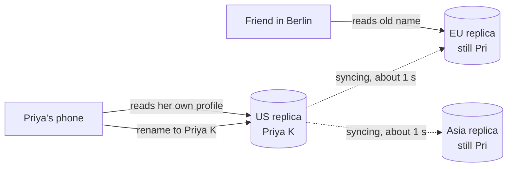

# Eventual Consistency

> Eventual consistency means replicas can disagree for a while, but if writes stop, they all end up with the same data. You get speed and availability, and you accept reads that are briefly stale.

## How it works

A write goes to one replica and spreads to the others in the background. Until it arrives, different replicas give different answers. The only promise is convergence: stop writing, wait a bit, and every replica agrees.

"Eventually" has no deadline. Usually it's tens of milliseconds. Under heavy load or during a partition, it can be minutes. The raw guarantee is weak, so real systems add stronger promises for each user:

- **Read your writes.** After you change something, you always see your change. Send a user's reads to the replica they wrote to, or to the leader, for a few seconds after each write.
- **Monotonic reads.** Time never goes backward for you. Pin each user to one replica, so a refresh can't show older data than the page they just saw.

Then there are conflicts. If two replicas accept writes to the same item at the same moment, something has to decide. Last write wins, or LWW, keeps the write with the latest timestamp and silently drops the other. It's simple, and it's what Cassandra does. The alternatives: keep both versions and let the app merge them, or use CRDTs, data types built to merge on their own, like a counter that just adds up increments from every replica.

The catch: last write wins trusts timestamps from different machines, and machine clocks drift. A write that really happened second can lose because its server's clock was 50 ms behind. If losing a write matters, don't use LWW.

## Example

A social feed stores profiles on replicas in 3 regions. Priya renames herself from "Pri" to "Priya K". A friend in Berlin sees the old name for about a second. Nobody notices, and that's the point: names, likes, and follower counts don't need to be instantly correct everywhere.

Then a bug report comes in. Priya refreshed and saw "Pri" again, because her refresh hit a replica that hadn't caught up. The team adds read your writes: for 10 seconds after a profile edit, Priya's own reads go to the replica she wrote to. Friends still read from whichever replica is closest. Priya sees her new name every time, and the feed stays fast.

## Picture it

Priya's write lands on the US replica and spreads to the others in the background. Her friend briefly reads the old name from the EU replica, while Priya's own reads go to the replica that already has her change.

## Related

[CAP Theorem](cap-theorem.md) · [Strong Consistency](strong-consistency.md) · [Read Replicas](../09-data-at-scale/read-replicas.md) · [Clock Skew](clock-skew.md) · [Merkle Trees](../09-data-at-scale/merkle-trees.md)
