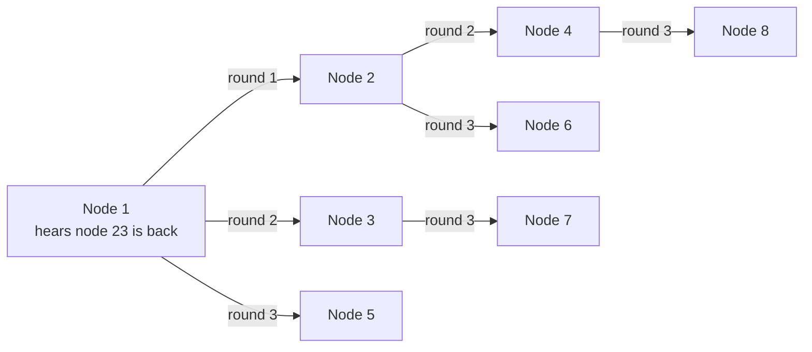

# Gossip Protocol

> In a gossip protocol, every node regularly swaps news with a few random peers. Like a rumor at a party, an update reaches the whole cluster in a handful of rounds, with no central server in charge.

## How it works

Every second or so, each node picks a random peer, or a few, and they compare notes: which nodes exist, which seem up, each node's latest heartbeat counter, maybe its load. For every entry, both sides keep whichever version is newer. Next round, they each pass that on to someone else.

News spreads fast because every node that hears it becomes a messenger. One node knows, then 2, then 4, then 8. In a 1,000 node cluster, that's about 10 rounds, or a few more since some news lands on nodes that already know. Seconds, not minutes. No node ever talks to everyone, so the work per node stays flat as the cluster grows. There's no central server to fail, either. Any node can die and the rumor routes around it.

Cassandra uses gossip for cluster membership. Every second, each node gossips with up to three others about every node it knows. Failure detection rides along: if a node's heartbeat counter stops climbing in the gossip everyone receives, each node decides on its own that it's probably down. Consul and Redis Cluster use gossip too.

The tradeoff: gossip is eventually consistent. For a few seconds, nodes disagree about who's in the cluster. That's fine for membership and health, and wrong for anything that needs one agreed answer, like who holds a lock or which node is the leader.

Watch out: a new node has to know at least one existing member to join. Cassandra calls these seed nodes. Give two halves of a cluster seed lists that only name their own half, and you can end up with two clusters that gossip happily among themselves and never meet.

## Example

A photo sharing app stores comments in a 60 node Cassandra cluster. At 3 AM, node 23 loses power.

Nobody announces it. Node 23 simply stops gossiping, so its heartbeat counter stops climbing. Every other node keeps seeing that frozen counter in the gossip it receives, and within about 20 seconds each one decides on its own that node 23 is down. Requests for the comments it stores go to the other two replicas instead, and users don't notice a thing.

When node 23 reboots, it contacts a seed node, its heartbeat starts climbing again, and the good news spreads the same way. The on call engineer reads about it over breakfast.

## Picture it

Each round, every node that has the news passes it to one random peer. One node knows, then 2, then 4, then 8. That doubling is why news like node 23 coming back reaches a big cluster in a handful of rounds.

## Related

[Heartbeats](heartbeats.md) · [Eventual Consistency](eventual-consistency.md) · [Service Discovery](../15-architecture/service-discovery.md) · [Consistent Hashing](../09-data-at-scale/consistent-hashing.md) · [Leader Election](../11-coordination/leader-election.md)

---

[← Heartbeats](heartbeats.md) · [All concepts](../../README.md) · [Leader Election →](../11-coordination/leader-election.md)
