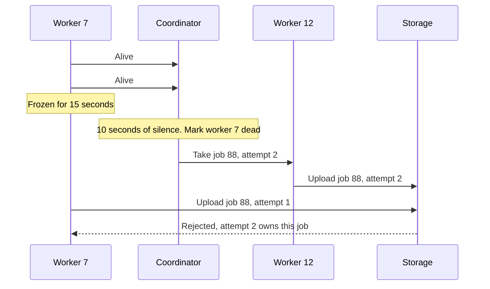

# Heartbeats

> A heartbeat is a tiny "I'm alive" message a server sends every few seconds. When the heartbeats stop, the rest of the system assumes it's dead and moves its work elsewhere.

## How it works

A worker sends a small message to a coordinator on a fixed interval, say every 2 seconds. The coordinator remembers when it last heard from each worker. If a worker stays silent past the timeout, say 10 seconds, the coordinator marks it dead: it stops sending it traffic, hands its jobs to someone else, or promotes a replica in its place.

Some systems flip it around, and the coordinator pings each node and waits for a reply. Either way, you tune the same knobs:

- **Interval.** How often to send. Shorter catches failures sooner but costs more messages. 1,000 nodes beating every second is 1,000 messages a second.
- **Timeout.** How long silence lasts before you give up. Usually several intervals, so one dropped packet doesn't get anyone killed.
- **Payload.** A heartbeat can carry load or queue length, so the coordinator learns more than just "alive".

The tradeoff is speed versus false alarms. Silence doesn't mean dead. A node might be frozen in a long garbage collection pause, swapping memory to disk, or stuck behind a congested link. Declare it dead too soon and you get a false positive: its work is handed out again while it's still running.

The catch: a node you declared dead doesn't know it. It wakes from a 15 second pause and carries on, writing results for a job someone else now owns. Guard against that with leases, a time limited right to do the work that heartbeats keep renewing, and fencing tokens, an increasing number the storage checks so it can reject writes from an old owner.

## Example

A video streaming site spreads new uploads across 40 transcoding workers, which convert each video into every quality level. Each worker sends a heartbeat every 2 seconds, and the coordinator gives up on a worker after 10 seconds of silence.

Worker 7 hits a 15 second garbage collection pause halfway through a 4K video. The coordinator hears nothing, marks it dead, and hands the job to worker 12. Then worker 7 wakes up, finishes, and uploads its files over worker 12's. The playlist now points at a mix of both, and the video stutters.

Two changes fix it. Every assignment carries an attempt number, and storage rejects uploads from an older attempt. And the timeout goes up to 30 seconds, because a transcode finishing 20 seconds late bothers nobody.

## Picture it

Worker 7 is alive but frozen, so the coordinator wrongly declares it dead and gives the job to worker 12. When worker 7 wakes up and uploads, its old attempt number gives it away, and storage turns it down.

## Related

[Health Checks](../14-reliability/health-checks.md) · [Gossip Protocol](gossip-protocol.md) · [Network Partitions](network-partitions.md) · [Leader Election](../11-coordination/leader-election.md) · [Distributed Locks](../11-coordination/distributed-locks.md)

---

[← Logical Clocks](logical-clocks.md) · [All concepts](../../README.md) · [Gossip Protocol →](gossip-protocol.md)
