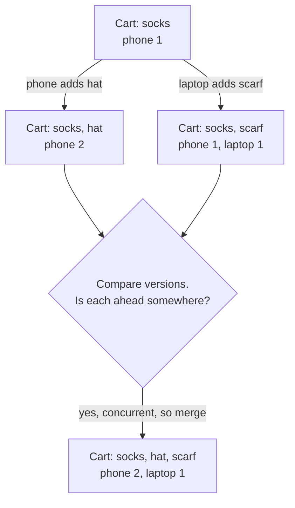

# Logical Clocks

> Logical clocks order events with counters instead of wall clock time. They tell you what happened before what, even when every server's clock is wrong.

## How it works

You often don't need to know when something happened, only whether A happened before B. A happened before B if both ran on the same machine and A came first, or if A sent a message and B is that message arriving. Chain those links together and you get cause and effect, with no clocks involved.

A Lamport clock is a single counter kept by each process, meaning each server, app, or device:

1. Before each event, add 1 to your counter.
2. Attach your counter to every message you send.
3. When a message arrives, set your counter to the bigger of yours and the message's, then add 1.

If A caused B, A's number is smaller. The reverse doesn't hold: a smaller number doesn't prove A caused B, since the two might be unrelated. So Lamport clocks give you one order everyone agrees on (break ties by process ID), but they can't spot events that happened independently.

A vector clock can. Each process keeps one counter per process, like `{phone: 3, laptop: 1}`. To compare two versions, look at every entry. If one version is behind or equal in all of them, it came first. If each is ahead somewhere, they're concurrent: neither saw the other, so you have a real conflict to merge. Amazon's Dynamo used vector clocks to catch conflicting shopping cart updates.

The catch: vector clocks grow with every process that writes. With thousands of writers, the vectors get huge, so real systems trim old entries or count per server instead of per client.

## Example

An online store keeps shopping carts on replicas that accept writes independently. A shared family cart holds socks, at version `{phone: 1}`.

Dad adds a hat on his phone, making it `{phone: 2}`. At the same moment, Mom adds a scarf on the laptop, which last saw `{phone: 1}`. Her version becomes `{phone: 1, laptop: 1}`.

When the replicas sync, the store compares the two versions. Dad's is ahead on phone, Mom's is ahead on laptop. Neither came first, so they're concurrent. Instead of picking one, the store merges the carts: socks, hat, and scarf. The merged clock takes the larger count from each, `{phone: 2, laptop: 1}`, and the next save of the cart ticks it again.

With last write wins on timestamps, either the hat or the scarf would have quietly vanished.

## Picture it

The cart splits into two versions from the same starting point. Each one is ahead on a different counter, so the vector clock flags them as concurrent, and the store merges them instead of throwing one away.

## Related

[Clock Skew](clock-skew.md) · [Eventual Consistency](eventual-consistency.md) · [Quorum](quorum.md) · [Replication](../09-data-at-scale/replication.md) · [Race Conditions](../12-concurrency/race-conditions.md)

---

[← Clock Skew](clock-skew.md) · [All concepts](../../README.md) · [Heartbeats →](heartbeats.md)
