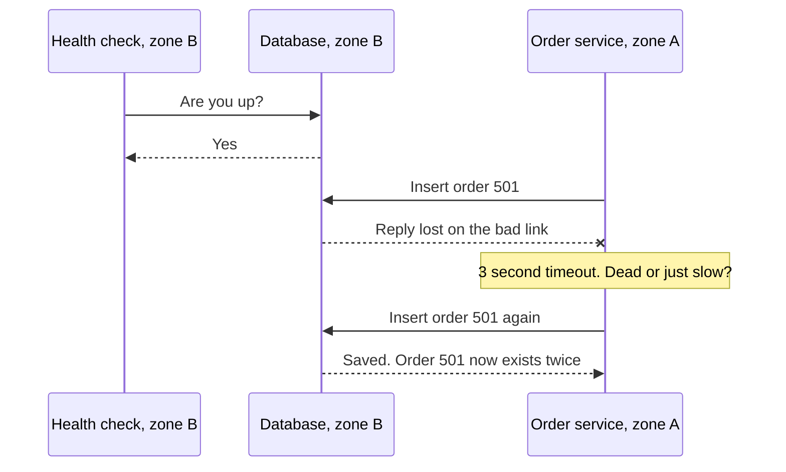

# Network Partitions

> A network partition is when some machines can't reach others, even though they're all still running. It happens far more often than people expect, and it's the root of most distributed systems headaches.

## How it works

The first of the classic fallacies of distributed computing is "the network is reliable". It isn't. Switches die, cables get cut, someone pushes a bad firewall rule, a cloud zone loses its uplink. From the inside, all of these look the same: messages stop arriving.

Real partitions are rarely a clean split into two halves. Some are partial: A can reach B, and B can reach C, but A can't reach C. Some are one way: A's messages reach B, but B's replies never come back. Some just drop 30% of packets, so things work slowly and fail at random. These messy cases cause more outages than clean ones, because half the system thinks everything is fine.

The deeper problem is that you can't tell slow from dead. You send a request and hear nothing for 2 seconds. Maybe the other server crashed. Maybe it's overloaded, or frozen in a long garbage collection pause. Maybe it did the work and the reply got lost. A timeout is a guess, not a fact. Set it short and you declare healthy servers dead. Set it long and users wait.

So every distributed design has to answer one question: during a partition, does each side keep serving and risk disagreeing, or stop and stay correct? That's the question the [CAP Theorem](cap-theorem.md) is about.

The catch: treating "timed out" as "failed". The write may well have happened. Only retry it if it's idempotent, or check first.

## Example

A food delivery app runs its order service in zone A and its database in zone B. One evening, a faulty switch between the zones starts dropping 30% of packets.

Nothing is down. The database's health checks run inside zone B and pass every time, so no failover happens. But in zone A, a third of order requests hang until the 3 second timeout. The app shows an error, hungry users tap Order again, and some restaurants get the same order twice, because the first write had actually landed.

The fixes: give every order an idempotency key so retries are harmless, run health checks from where the callers are, and alert on timeout rates, not only on servers being up.

## Picture it

The health check sits next to the database, so it sees nothing wrong. The order service is across the bad link, loses a reply, and can't tell if the write happened. Its retry creates a second order.

## Related

[CAP Theorem](cap-theorem.md) · [Timeouts](../14-reliability/timeouts.md) · [Heartbeats](heartbeats.md) · [Split Brain](../11-coordination/split-brain.md) · [Fallacies of Distributed Computing](../23-laws/fallacies-of-distributed-computing.md)

---

[← Unique ID Generation](../09-data-at-scale/unique-id-generation.md) · [All concepts](../../README.md) · [CAP Theorem →](cap-theorem.md)
