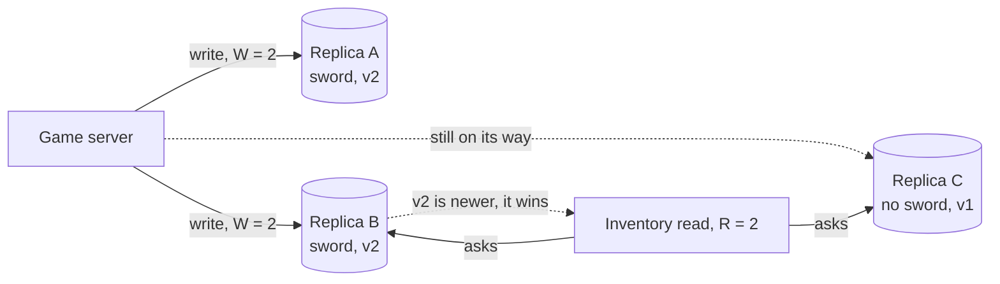

# Quorum

> A quorum is the minimum number of replicas that must respond before a read or write counts. Pick the numbers right and every read is guaranteed to include at least one copy of the latest write.

## How it works

Say each item is stored on N replicas, usually 3. On a write, the client sends it to all of them and waits for W to confirm. On a read, it asks the replicas, waits for R answers, and keeps the newest version among them.

The rule is R + W > N. If that holds, the set of replicas you read from and the set that took the latest write always overlap by at least one. With N = 3, W = 2, R = 2, any 2 replicas you read include at least one of the 2 that got the write. That replica's version number tells the client it has the newest value.

The numbers are knobs that trade speed against freshness:

| N, W, R | What you get |
|---|---|
| 3, 2, 2 | Balanced. Reads and writes both survive one dead replica |
| 3, 3, 1 | Fast reads, but a write fails if any replica is down |
| 3, 1, 3 | Fast writes, but a read fails if any replica is down |
| 3, 1, 1 | Fastest, but a read can miss the latest write |

Cassandra and other Dynamo style databases let you choose per query. Cassandra's `QUORUM` level means a majority, so 2 of 3.

Watch out: quorums give you overlap, not full consistency. Two writes to the same item at the same moment can land on different replicas and still need a tiebreaker. A write that reached only 1 of 3 replicas before failing isn't rolled back, so a later read may or may not see it.

## Example

A multiplayer game stores player inventories in Cassandra, 3 replicas per player. To keep things snappy, it reads and writes at `ONE`, so W = 1 and R = 1.

A player spends 500 gems on a sword. The write lands on replica A and is still on its way to the others. The player opens their inventory, the read hits replica C, and the sword isn't there. So they buy it again. Support gets the ticket.

Switching both reads and writes to `QUORUM` closes the gap: every read now includes a replica that has the sword. Requests wait for the second fastest replica instead of the fastest, which adds a couple of milliseconds. And when one replica restarts during a patch, both reads and writes keep working.

## Picture it

The write counts once A and B have it. The read asks B and C. C is behind, but B is in both sets, so the read sees v2 and returns the sword. With 3 replicas, any 2 and any 2 always share one.

## Related

[Replication](../09-data-at-scale/replication.md) · [Strong Consistency](strong-consistency.md) · [Eventual Consistency](eventual-consistency.md) · [Consensus](../11-coordination/consensus.md) · [CAP Theorem](cap-theorem.md)

---

[← Eventual Consistency](eventual-consistency.md) · [All concepts](../../README.md) · [Clock Skew →](clock-skew.md)
