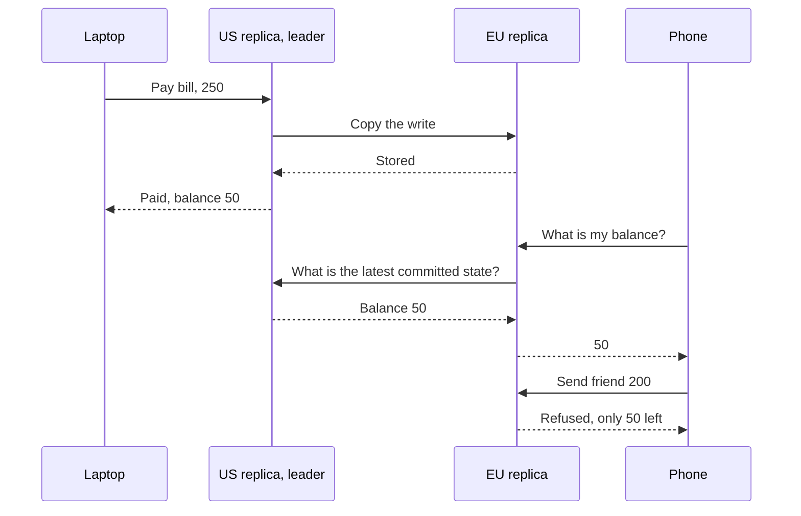

# Strong Consistency

> Strong consistency means a system with many copies of the data behaves as if there's only one. Once a write succeeds, every later read, from any server, sees it.

## How it works

The formal name is linearizability. In plain words: every read and write appears to happen at a single instant, in one order that everyone agrees on, and that order matches real time. If a write finished before a read started, the read sees the write. Once any client has seen a new value, no client ever sees the old one again.

That sounds like the obvious default, but replicas make it hard. A write lands on one node and takes time to reach the others. To stay strongly consistent, the system usually waits until a majority of replicas have the write before it says "done", and reads have to confirm with the leader or a majority that nothing newer exists. etcd and Google Spanner do this with consensus protocols like Raft and Paxos.

The price is latency. Every write needs at least one round trip to a majority of replicas. Inside one data center, that's under a millisecond. Across regions, you're fighting the speed of light: replicas in Virginia, Oregon, and Ireland add something like 60 to 80 ms to every write. And during a partition, the side without a majority can't answer at all, which is the CP choice from the CAP theorem.

Use it where a stale read causes real damage: balances, inventory counts, locks, usernames that must be unique. Skip it for likes, view counts, and feeds.

Watch out: one cache in front of a strongly consistent database throws the guarantee away. The database is linearizable, the cache serves a value from 30 seconds ago, and your app is now eventually consistent with extra steps.

## Example

A wallet app stores balances in 3 regions. Ana has $300. She pays a $250 bill from her laptop, which writes to the US region. Two seconds later her phone, routed to the EU region, still shows $300, so she sends a friend $200. With async replication, both payments go through, and the account ends up $150 overdrawn.

With a strongly consistent store running Raft across the three regions, the bill payment only returns once 2 of the 3 regions have it. The phone's balance check confirms with the leader and sees $50, so the $200 transfer is refused. Each payment now takes about 80 ms longer. For money, that's a bargain.

## Picture it

The laptop's payment only counts once a majority of replicas store it. The phone's read checks with the leader before answering, so it can never see the old $300, and the second payment is refused.

## Related

[CAP Theorem](cap-theorem.md) · [Eventual Consistency](eventual-consistency.md) · [Quorum](quorum.md) · [Consensus](../11-coordination/consensus.md) · [Isolation Levels](../07-databases/isolation-levels.md)

---

[← CAP Theorem](cap-theorem.md) · [All concepts](../../README.md) · [Eventual Consistency →](eventual-consistency.md)
