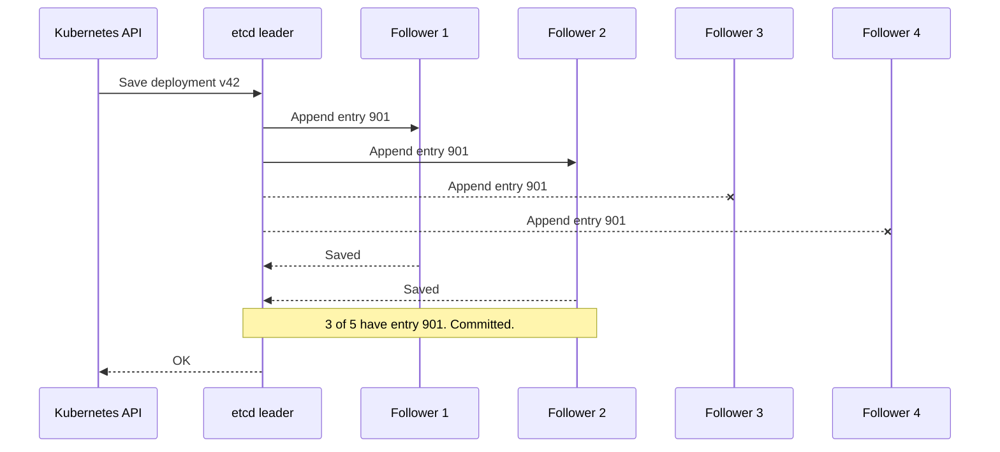

# Consensus

> Consensus lets a group of servers agree on the same ordered list of changes, even while some of them are down. A change counts once a majority has saved it.

## How it works

Raft and Paxos are the famous algorithms. Raft is the one you'll meet in most newer tools, because it was designed to be easier to understand. Both run on one idea: majority rules.

One server is the leader. Every write goes to it. The leader adds the write to its log, an ordered list of changes like "entry 41: set price to 12", and sends the entry to the followers. Once a majority of servers, leader included, have saved it to disk, the entry is committed: from then on it can't be lost, and every server applies it in the same order. If the leader goes quiet, a follower waits a short random time, asks the others for votes, and takes over once a majority says yes.

Why a majority? Any two majorities share at least one server. So a new leader's voters always include someone who saw every committed entry, and two halves of a split network can never both make progress.

That's also why clusters come in odd sizes:

| Servers | Majority | Can lose |
|---|---|---|
| 3 | 2 | 1 |
| 4 | 3 | 1 |
| 5 | 3 | 2 |

The catch: a fourth server buys you nothing. It survives the same single failure as 3, and every write now waits on one more answer. Go from 3 to 5, not 3 to 4.

etcd and Consul run Raft. ZooKeeper uses a close cousin called Zab. You almost never write this yourself. You run one of these tools and keep your small, important data in it: config, leaders, locks.

## Example

A ride sharing app runs on Kubernetes, which stores all of its cluster state in etcd. The team runs 5 etcd servers across 3 zones, split 2, 2, and 1.

Zone B goes dark and takes 2 servers with it. 3 of 5 are left, still a majority, so deploys and autoscaling keep working. Nobody notices.

An hour later, one more server crashes. Now 2 of 5 remain. That's not a majority, so etcd stops accepting writes. Running pods keep serving riders, but nothing new can be deployed or scaled until a third server comes back.

Had they put 3 servers in zone B, that one zone outage would have frozen the cluster on its own. Spread the servers so that no single zone holds a majority.

## Picture it

Followers 3 and 4 sit in the dead zone and never answer. It doesn't matter. The leader plus followers 1 and 2 make 3 of 5, a majority, so the write is committed and the API gets its OK.

## Related

[Leader Election](leader-election.md) · [Quorum](../10-distributed-systems/quorum.md) · [Split Brain](split-brain.md) · [Replication](../09-data-at-scale/replication.md) · [FLP Impossibility](../23-laws/flp-impossibility.md)

---

[← Leader Election](leader-election.md) · [All concepts](../../README.md) · [Split Brain →](split-brain.md)
