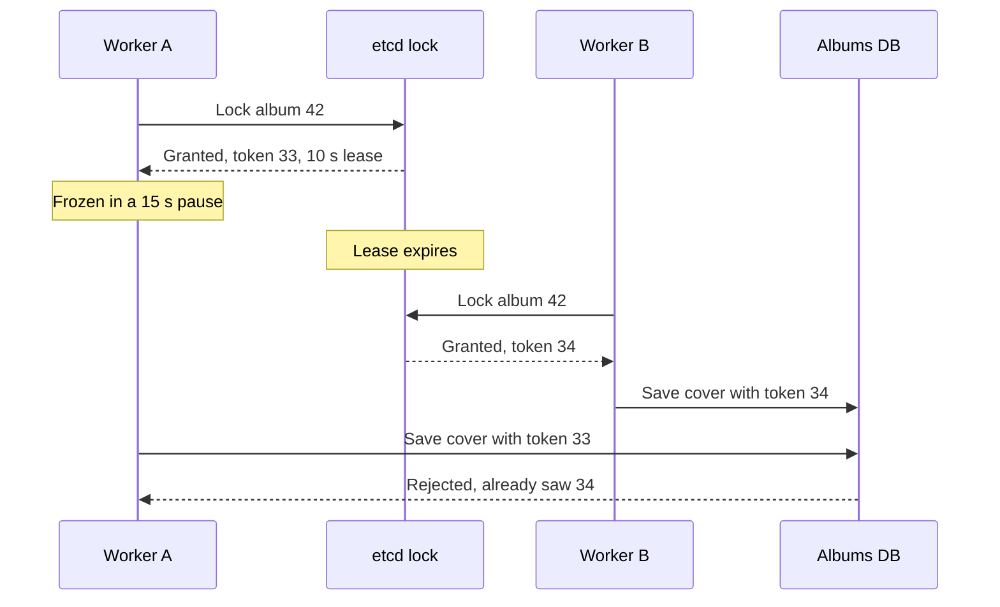

# Distributed Locks

> A distributed lock makes sure only one process, across many machines, works on a thing at a time. The hard part isn't taking the lock, it's knowing you still hold it.

## How it works

Inside one program you'd use a mutex. Across 10 servers you need a lock that lives somewhere they can all reach. With Redis, taking one is a single command: `SET lock:album:42 worker-a NX PX 10000`. `NX` means only set it if nobody holds it. `PX 10000` makes it expire after 10 seconds.

That expiry is the lease, and you need it. Without one, a worker that crashes while holding the lock keeps it forever. To release, delete the key, but only if it still holds your value, or you might free someone else's lock.

Watch out: the paused process. Worker A takes the lock and then freezes. Maybe a long garbage collection pause, where the runtime stops the program to clean up memory, or the host paused its VM. 15 seconds later it wakes up, sure it still holds the lock. But the lease ran out after 10, and worker B has been working for 5. Both now write. No lease length fixes this, because a pause can always be longer.

The fix is a fencing token. Every time the lock is granted, the lock service hands out a number that only goes up: 33, then 34. The worker sends its token with every write, and the storage rejects any token lower than the highest it has seen. A's late write with 33 bounces. etcd and ZooKeeper give you a number like this for free. A plain Redis lock doesn't.

So ask what happens if two workers ever hold it at once. If the answer is "some duplicate work", a Redis lock is fine. If it's "corrupted data or lost money", you need fencing tokens, checked by the storage itself.

## Example

A photo sharing app rebuilds an album's cover collage whenever someone adds a photo. Two workers writing the same cover at once leave a broken image, so each one takes an etcd lock on the album first.

Worker A gets the lock with token 33 and a 10 second lease, then stalls in a 15 second pause. The lease expires. Worker B gets the lock with token 34 and saves a cover with the new photo. A wakes up and saves its stale cover on top.

With fencing, every save carries the token, and the albums table keeps the last one it accepted:

```sql
UPDATE albums
SET cover_url = 'covers/42/v9.jpg', fence = 33
WHERE id = 42 AND fence <= 33;
-- B already saved with fence 34, so 0 rows change
```

A's write becomes a no op, and B's cover stays.

## Picture it



Worker A wakes up still believing it holds the lock. The lock service can't stop it, but the database can: token 33 is lower than 34, so the stale write is refused.

## Related

[Leader Election](leader-election.md) · [Split Brain](split-brain.md) · [Race Conditions](../12-concurrency/race-conditions.md) · [Garbage Collection](../12-concurrency/garbage-collection.md) · [Pessimistic Locking](../12-concurrency/pessimistic-locking.md)

---

[← Split Brain](split-brain.md) · [All concepts](../../README.md) · [Distributed Transactions →](distributed-transactions.md)
