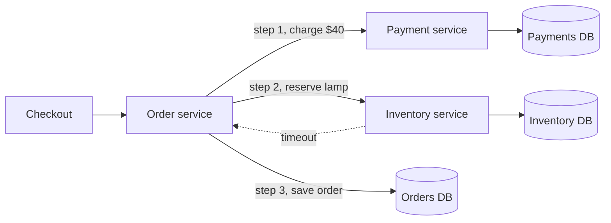

# Distributed Transactions

> A distributed transaction changes data in several services or databases as one unit: every change happens, or none does. One database gives you that for free, but across three you have to build it.

## How it works

Inside one database, a transaction is easy. You `BEGIN`, make 5 changes, `COMMIT`, and the database makes sure all 5 land or none do. Split your app into an order service, a payment service, and an inventory service, each with its own database, and that guarantee is gone. No single `COMMIT` covers all three. If the card is charged and then the inventory call fails, the customer paid for nothing.

Before reaching for a pattern, ask if you need one. Data that must always change together probably belongs in one database. If it really can't, there are three main tools:

- **Two phase commit.** A coordinator asks every database "can you commit?" and only says "commit" once all of them say yes. True all or nothing, but slow, and everyone waits if the coordinator dies.
- **Saga.** Each service commits its own step right away. If a later step fails, earlier steps get undone with compensating actions, like a refund. No waiting, but for a few seconds the world can see a charge with no order.
- **Outbox.** Write your change and the event announcing it in one local transaction, and let a separate process publish the event. It makes "save, then tell the others" reliable, and sagas usually run on top of it.

In microservices, sagas plus an outbox is the common answer.

The catch: you probably have a distributed transaction already, without calling it one. Saving an order to Postgres and then publishing `OrderPlaced` to Kafka touches two systems. Crash between the two, and one of them never hears about the order.

## Example

An online store sells a $40 lamp. Checkout does three things: charge the card through the payment service, reserve the lamp in the inventory service, and save the order.

One Friday the inventory service times out on every third call. Each time, the card charge has already gone through. By Monday, 212 customers have paid for orders that don't exist, and support is issuing refunds by hand.

The team turns checkout into a saga. Reserve stock first, since it's the step most likely to fail. Then charge. Then save the order. If the charge fails, release the stock. If saving fails, refund and release the stock. Each step publishes its result through an outbox, so a crash never loses track of a step. Customers now either get an order or get their money back automatically.

## Picture it

Three services, three databases, and no transaction that spans them. Step 1 is already done when step 2 fails, so the system needs a plan for undoing it, or for coordinating all three up front.

## Related

[Two Phase Commit](two-phase-commit.md) · [Saga Pattern](saga-pattern.md) · [Outbox Pattern](../13-messaging/outbox-pattern.md) · [ACID Transactions](../07-databases/acid-transactions.md) · [Monolith vs Microservices](../15-architecture/monolith-vs-microservices.md)
