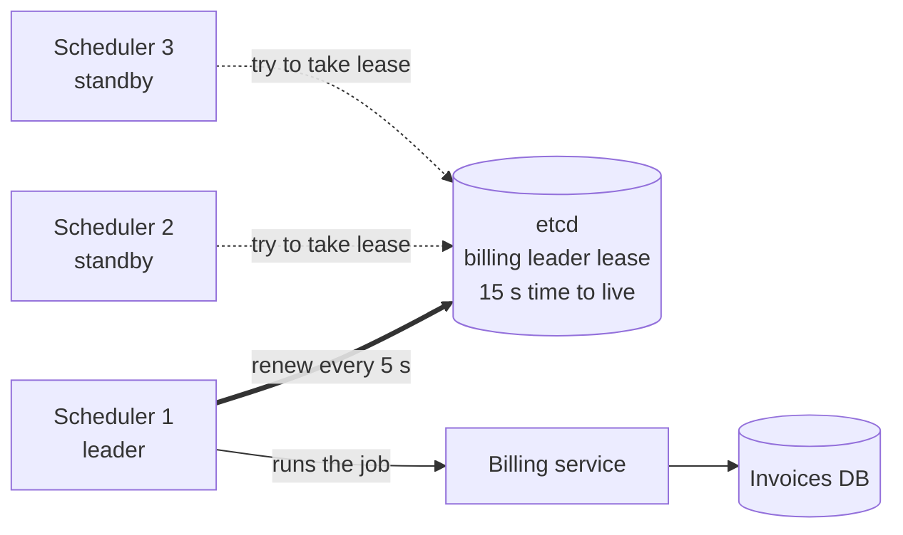

# Leader Election

> Leader election picks exactly one server out of several to do a job that must not run twice, and picks a new one fast when that server dies.

## How it works

Some work must happen exactly once: sending the monthly invoices, running the nightly cleanup, accepting writes for a database. You run 3 copies for safety, but only one may act. That one is the leader. The others wait on standby.

The usual tool is a lease, which is a lock with a timer. A server grabs a key like `billing-leader` in a shared store with a 15 second time to live. While it holds the key, it's the leader, and it renews the lease every 5 seconds. If it crashes or loses its network, the renewals stop, the lease expires, and a standby grabs the key. Failover takes about 15 seconds and needs no human.

The shared store must not be fooled by a broken network, so people reach for one of these:

- **etcd.** A small key value store with leases and a built in election API. Kubernetes keeps all its state there, including the Lease objects its own controllers use to pick a leader.
- **ZooKeeper.** Each candidate creates a temporary numbered entry. The lowest number leads, and the entry vanishes when its owner's session dies.
- **Consul.** Sessions and locks built on the same kind of majority voting.

Watch out: rolling your own. "The alive server with the lowest ID is the leader" works fine until the network splits. Each half sees the other as dead, and now you have two leaders. etcd, ZooKeeper, and Consul only grant a lease when a majority of their own servers agree. That's the hard part, and someone already got it right.

## Example

A SaaS dashboard bills its customers on the 1st of each month. The billing scheduler runs on 3 servers so one crash can't skip billing.

Before leader election, all 3 servers fire the job at midnight. Every customer gets 3 invoices, and some cards get charged 3 times. Support has a long morning.

After: each server tries to take the `billing-leader` lease in etcd. Server 1 wins and starts billing. At 00:03 it runs out of memory and dies. Its lease runs out within 15 seconds. Server 2 takes it and picks up from the last invoice marked as sent. One invoice per customer, and nobody got paged.

The job still has to be safe to resume, because the old leader might have died halfway through invoice 4,812.

## Picture it

Only scheduler 1 holds the lease, so only it talks to the billing service. The other two keep asking etcd. The moment scheduler 1 stops renewing, one of them gets the lease and takes over.

## Related

[Consensus](consensus.md) · [Split Brain](split-brain.md) · [Distributed Locks](distributed-locks.md) · [Heartbeats](../10-distributed-systems/heartbeats.md) · [Cron Jobs](../13-messaging/cron-jobs.md)
