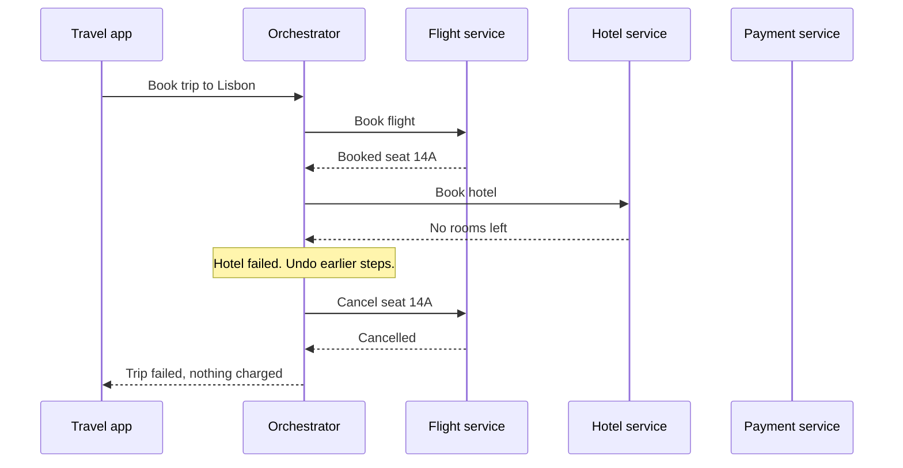

# Saga Pattern

> A saga splits one big transaction across services into a chain of small local ones. If a step fails, it runs compensating actions to undo the steps that already happened.

## How it works

Booking a trip touches three services: flights, hotels, payments. A saga runs them as separate steps, and each step commits in its own database right away. No global lock, no waiting on anyone.

Every step comes with a compensating action that undoes it in business terms. Book a seat, cancel the seat. Charge a card, refund it. If step 3 fails, the saga runs the compensations for steps 2 and 1, in reverse. That's not a rollback. The seat really was booked for a few seconds, and another customer may have seen it as taken.

Two ways to run the chain:

- **Orchestration.** One orchestrator service tells each service what to do next and remembers where the saga is. Easy to follow and debug. Workflow engines like Temporal and AWS Step Functions are built for this.
- **Choreography.** No boss. Each service listens for events and reacts. The hotel service hears `FlightBooked` and books a room. The flight service hears `HotelFailed` and cancels. Loosely coupled, but past 4 or 5 steps nobody can follow the flow without a whiteboard.

Order the steps with care. Put the ones most likely to fail first, and the ones you can't undo, like sending a confirmation email, last.

Watch out: compensations fail too. The refund call can time out just like the charge did. Make every step and every compensation idempotent, meaning running it twice does the same as running it once, then keep retrying until it lands. A saga that gives up halfway leaves a customer with a flight and no hotel.

## Example

A travel site books a Lisbon trip: a $320 flight, then a $540 hotel, then the card charge. An orchestrator runs it.

The flight books fine, seat 14A. The hotel answers "no rooms left". The orchestrator marks the saga as failing and tells the flight service to cancel seat 14A. That call times out, so it retries 2 seconds later, and it works. About 5 seconds after tapping "Book", the customer sees "That hotel just sold out. Nothing was charged."

Because the charge was the last step, there was nothing to refund. Had the charge come first, a failed hotel would mean a refund, and refunds can take days to show up on a statement.

## Picture it

Each step commits on its own. When the hotel fails, the orchestrator walks backward and cancels the flight. The payment service never gets a call, because charging was saved for last.

## Related

[Distributed Transactions](distributed-transactions.md) · [Two Phase Commit](two-phase-commit.md) · [Outbox Pattern](../13-messaging/outbox-pattern.md) · [Idempotency](../14-reliability/idempotency.md) · [Event Driven Architecture](../13-messaging/event-driven-architecture.md)

---

[← Two Phase Commit](two-phase-commit.md) · [All concepts](../../README.md) · [Race Conditions →](../12-concurrency/race-conditions.md)
