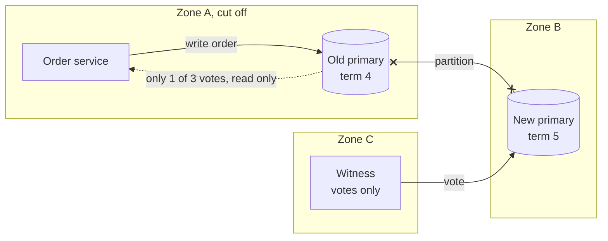

# Split Brain

> Split brain is when two servers both believe they are the leader and both accept writes. Your data forks into two histories, and someone has to stitch them back together by hand.

## How it works

It starts with a failover. The standby can't hear the leader, decides it's dead, and takes over. But the leader wasn't dead. The network between them dropped, or the leader froze for 20 seconds. Now both act as leader, and clients on each side happily write to their own.

The damage is concrete: two different orders with the same ID, the same seat sold twice, a balance that's right on one side and wrong on the other. When the network heals, there's no clean way to merge.

Two fixes, and serious systems use both:

- **Majority quorum.** A server may only lead while it can reach a majority of voters. With 3 voters split 1 and 2, only the side with 2 can elect anyone. The lone old leader sees it lost its majority and stops taking writes.
- **Fencing.** Every new leader gets a higher number, called a term or epoch. Storage and other services remember the highest term they've seen and reject anything older. So a stale leader's writes bounce even if it never got the news. The blunt version is called STONITH, "shoot the other node in the head": cut the old leader's power or network before the new one starts.

The catch: two servers can't settle a disagreement. In a 2 server pair, each side sees 1 of 2. Either both freeze, or the failover tool guesses, and guessing is how split brain happens. Add a third voter, even a tiny witness server in another zone that stores no data and only votes.

## Example

A food delivery app runs its orders database as a primary in zone A and a replica in zone B. A failover tool in zone B promotes the replica after 3 missed health checks.

One evening the link between zones drops for 40 seconds. The tool promotes B. But A is fine, and the order service in zone A keeps writing to it. For 40 seconds both sides create orders, and order 50213 now exists twice, for two different customers. Two engineers spend the next day reconciling.

The fix: a small witness in zone C, and a rule that promotion needs 2 of 3 votes. Next time, B and the witness agree and promote B with term 5. A sees only itself, 1 of 3, and turns read only. Any write still stamped with term 4 gets rejected.

## Picture it

Zone A is cut off. B and the witness make 2 of 3 votes, so B becomes primary with term 5. The old primary can only count its own vote, so it refuses the write instead of starting a second history.

## Related

[Leader Election](leader-election.md) · [Network Partitions](../10-distributed-systems/network-partitions.md) · [Quorum](../10-distributed-systems/quorum.md) · [Failover](../21-disaster-recovery/failover.md) · [Consensus](consensus.md)

---

[← Consensus](consensus.md) · [All concepts](../../README.md) · [Distributed Locks →](distributed-locks.md)
