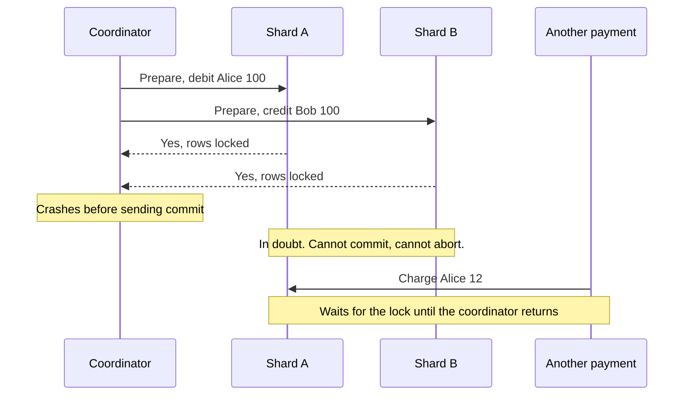

# Two Phase Commit

> Two phase commit makes several databases commit a change together or not at all. A coordinator asks everyone to promise first, then tells everyone to go.

## How it works

One process acts as the coordinator. The databases taking part are the participants.

1. **Prepare.** The coordinator sends the change to every participant. Each one does the work, writes it durably to disk, locks the rows, and votes yes or no. A yes is a promise: "I can commit this, even if I crash and restart."
2. **Decide.** If every vote is yes, the coordinator writes "commit" to its own log. If any vote is no, or a participant doesn't answer in time, it writes "abort".
3. **Commit.** The coordinator sends the decision to everyone. Participants commit or roll back, then release their locks.

You get real all or nothing across machines. The price is two network round trips per transaction, with locks held the whole time. It's slow, and it gets slower with every participant you add.

The catch: a dead coordinator blocks everyone. Say both databases voted yes and then the coordinator dies before sending the decision. The participants can't commit on their own, because another participant might have voted no. They can't roll back either, because the coordinator might have decided to commit. So they wait, rows locked, until it comes back. Every other transaction touching those rows waits too.

Systems that rely on it make the coordinator survive failures. Google Spanner runs two phase commit on top of consensus groups, so another copy of the decision always exists. Across ordinary databases, the XA standard and Postgres's `PREPARE TRANSACTION` let you do it yourself, but most teams pick sagas instead.

## Example

A bank keeps accounts on two Postgres shards. Alice is on shard A, Bob on shard B. Alice sends Bob $100. The coordinator debits on A and credits on B:

```sql
-- needs max_prepared_transactions above 0, it is off by default
BEGIN;
UPDATE accounts SET balance = balance - 100 WHERE id = 'alice';
PREPARE TRANSACTION 'tx_981';
-- once both shards have voted yes, on each one:
COMMIT PREPARED 'tx_981';
```

One night the coordinator crashes right after both shards prepare. Alice's and Bob's rows stay locked. Prepared transactions even survive a database restart, so rebooting the shards doesn't help. Alice's card payments time out for 20 minutes, until the coordinator comes back, reads its log, and finishes `tx_981`.

## Picture it



Both shards promised to commit, then lost the one server that knows the decision. They have to hold their locks and wait, so an unrelated $12 payment from Alice gets stuck behind them.

## Related

[Distributed Transactions](distributed-transactions.md) · [Saga Pattern](saga-pattern.md) · [Consensus](consensus.md) · [ACID Transactions](../07-databases/acid-transactions.md) · [Single Point of Failure](../02-scaling/single-point-of-failure.md)

---

[← Distributed Transactions](distributed-transactions.md) · [All concepts](../../README.md) · [Saga Pattern →](saga-pattern.md)
