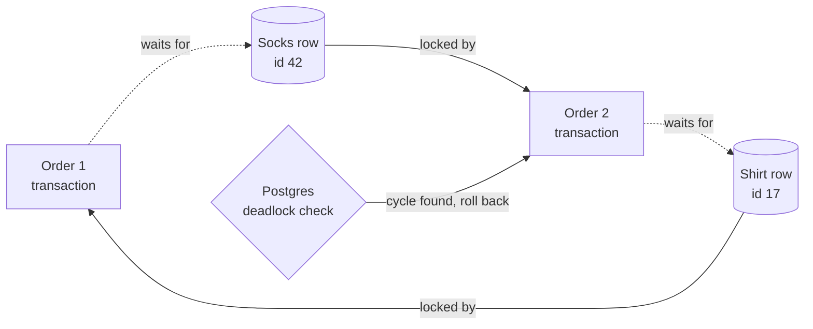

# Deadlocks

> A deadlock is two workers each holding a lock the other one needs, so both wait forever. Nothing crashes, things just stop.

## How it works

Transaction 1 locks row A and asks for row B. Transaction 2 already holds row B and asks for row A. Each waits for the other to let go, and neither will. Same story with threads and mutexes, or with services holding each other's resources.

A deadlock needs a cycle of waiting, so the fixes break the cycle:

- **Lock ordering.** Always take locks in the same order, like lowest ID first. If everyone grabs A before B, nobody can hold B while waiting for A.
- **Timeouts.** Don't wait forever. Give up after, say, 2 seconds, release what you hold, and retry.
- **Short transactions.** The fewer locks you hold, and the shorter you hold them, the smaller the window.

Databases also catch deadlocks for you. They track who is waiting on whom, and when they find a cycle, they pick one transaction as the victim, roll it back, and return an error. Postgres checks once a lock wait passes 1 second (`deadlock_timeout`). MySQL checks right away. The other transaction then gets its lock and finishes. Your code should catch that error and retry, because the victim did nothing wrong.

Watch out: only databases do this. Two threads deadlocked inside your own service just hang. CPU sits near zero, requests pile up, and a health check that doesn't touch those locks keeps answering 200 OK.

## Example

An online store updates stock in one Postgres transaction per order, locking rows in cart order. Order 1 has a shirt, then socks. Order 2, placed in the same millisecond, has socks, then a shirt.

Order 1 locks the shirt row. Order 2 locks the socks row. Each now waits for the other. After 1 second, Postgres spots the cycle and kills order 2 with `ERROR: deadlock detected`. During a flash sale this happens 30 times a minute, and each one is a failed checkout.

The fix is small. Sort the product IDs before updating, so every order locks the shirt (id 17) before the socks (id 42). Now order 2 just waits a few milliseconds behind order 1. And retry once on Postgres error code `40P01`, in case some other code path still deadlocks.

## Picture it

Follow the arrows around the loop. Order 1 waits for the socks, locked by order 2, which waits for the shirt, locked by order 1. That loop is the deadlock, and Postgres breaks it by rolling back one side.

## Related

[Pessimistic Locking](pessimistic-locking.md) · [Thread Safety](thread-safety.md) · [Timeouts](../14-reliability/timeouts.md) · [Retries](../14-reliability/retries.md) · [ACID Transactions](../07-databases/acid-transactions.md)
