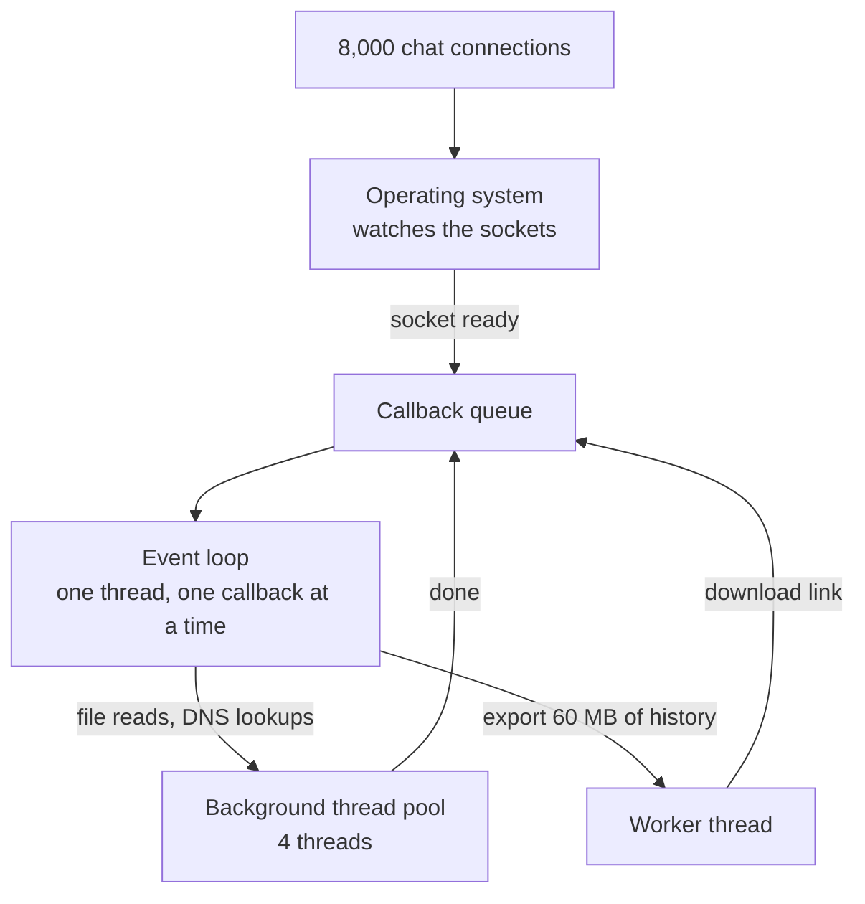

# Event Loop

> An event loop is one thread that runs short callbacks, one after another, while the waiting on networks and disks happens in the background. It juggles thousands of connections cheaply, until one slow callback stalls them all.

## How it works

Many servers used to give every connection its own thread. Threads cost memory, and most of them sit idle, waiting on the network. An event loop flips that around: one thread does all the work, and it never waits.

The loop really is a loop. Ask the operating system which sockets are ready, through epoll on Linux or kqueue on macOS. Run the callback for each ready event. Go back and ask again. While a database query is in flight, the thread isn't stuck on it. It runs callbacks for other requests, and when the reply lands, that socket becomes ready and its callback runs.

That's how one Node.js process can hold 10,000 open WebSocket connections. Node keeps network I/O on the loop and hands file reads, DNS lookups, and some crypto to a small pool of background threads, 4 by default. Nginx runs an event loop in each worker process, often one worker per CPU core. Redis runs every command on one main thread.

It only works if every callback is short. There's one thread, so while it runs your code, everything else waits:

- **CPU heavy work.** Resizing images, hashing passwords, or parsing a 50 MB JSON body.
- **Sync calls.** `fs.readFileSync` or `crypto.pbkdf2Sync` inside a request handler.
- **Runaway loops.** Sorting a million items, or a regex that backtracks for seconds on a nasty input.

The catch: one slow request freezes everyone, health checks included, so the load balancer may decide the whole server is dead. Move heavy work off the loop, into worker threads in Node, a job queue, or a separate service.

## Example

A chat app runs one Node.js process per CPU core, each holding about 8,000 WebSocket connections. Messages normally go out in under 5 ms.

Then the team ships "Export chat history". The handler loads a user's messages and calls `JSON.stringify` on 60 MB of them. That takes hundreds of milliseconds, on the event loop. For that whole stretch, the other 7,999 users on the process get nothing: no messages, no typing dots, and heartbeats miss their deadline. Five exports at once and the process looks dead.

The fix moves exports to a small pool of worker threads. The handler hands over the user ID and returns right away. A worker builds the file on its own thread and posts back a download link. Chat traffic on the event loop never notices.

## Picture it

The event loop only ever runs one callback at a time. Everything slow, from file reads to the big export, happens on other threads and comes back as a new callback in the queue.

## Related

[Thread Safety](thread-safety.md) · [WebSockets](../04-networking/websockets.md) · [Message Queues](../13-messaging/message-queues.md) · [Tail Latency](../01-performance/tail-latency.md) · [Backpressure](../13-messaging/backpressure.md)

---

[← Thread Safety](thread-safety.md) · [All concepts](../../README.md) · [Deadlocks →](deadlocks.md)
