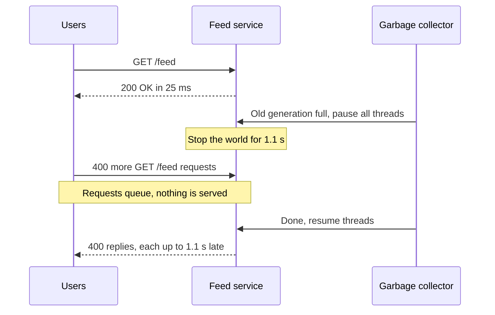

# Garbage Collection

> Garbage collection (GC) frees memory your program no longer uses, so you never have to free it by hand. The price is that the collector sometimes pauses your app, and those pauses land on your slowest requests.

## How it works

Java, Go, C#, and JavaScript all collect garbage for you. The collector starts from the roots, meaning local variables and globals, and follows every reference to mark what's still reachable. Anything it didn't reach is garbage and gets freed.

Most objects die young. A request builds a few thousand objects and drops them all 20 ms later. So collectors like Java's split memory into generations:

- **Young generation.** New objects land here. It's collected often and fast, because almost everything in it is already dead.
- **Old generation.** Objects that survive a few collections move here. It's collected rarely, and that's where the slow collections happen.

Some steps need the app frozen, so references don't shift while the collector walks them. That's a stop the world pause, and every request in flight just waits. A 300 ms pause every few minutes barely moves your average. But each request caught in it takes up to 300 ms longer, and those requests are your p99, the latency your slowest 1 in 100 requests sees.

The knobs: allocate less, since less garbage means fewer collections. Pick a low pause collector, like ZGC or Shenandoah for Java, which do most of the work while your app keeps running. Give the heap, the memory the collector manages, room to breathe, because a nearly full heap collects constantly.

The catch: GC pauses hide in averages. The dashboard looks calm while users hit random 1 second stalls. Plot p99 next to the GC log, and the spikes line up. A long enough pause can even miss heartbeats, so the rest of the cluster declares the server dead.

## Example

A social feed service runs on the JVM, Java's runtime, with a 16 GB heap. Average latency is 25 ms. But every 4 minutes, p99 jumps from 80 ms to 1.2 seconds.

The GC log has the answer. The service keeps 2 million feed items cached in memory, so the old generation fills up steadily. Each time it fills, a full collection freezes the app for about 1.1 seconds.

The team moves the cache to Redis and switches collectors:

```
java -XX:+UseZGC -Xmx16g -Xlog:gc -jar feed.jar
```

Collections now run alongside the app, with pauses under a millisecond. p99 settles at 70 ms, and the 4 minute spikes are gone.

## Picture it



Before the pause, a request takes 25 ms. During the pause the service is alive but frozen, so the 400 requests that arrive in that second all finish late. Those late requests are your p99.

## Related

[Memory Leaks](memory-leaks.md) · [P99 Latency](../01-performance/p99-latency.md) · [Tail Latency](../01-performance/tail-latency.md) · [Heartbeats](../10-distributed-systems/heartbeats.md) · [Distributed Locks](../11-coordination/distributed-locks.md)

---

[← Memory Leaks](memory-leaks.md) · [All concepts](../../README.md) · [Message Queues →](../13-messaging/message-queues.md)
