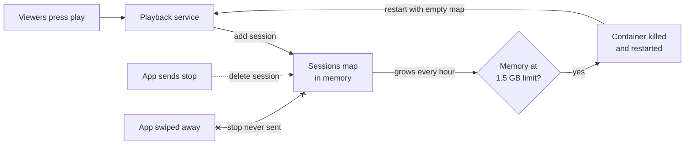

# Memory Leaks

> A memory leak is memory your service keeps holding but will never use again. In a long running service it piles up for hours, until the process gets killed for running out of memory.



## How it works

In languages with garbage collection, like Java, Go, or JavaScript, a leak isn't memory you forgot to free. It's memory you're still pointing at. The collector only frees what your code can no longer reach. If a global map still holds an object, that object stays, forever.

The usual suspects in a server:

- **Unbounded caches.** A plain map used as a cache, with no size limit and no expiry. Every new key stays.
- **Growing maps.** Entries added per user, session, or request, with cleanup that only runs on the happy path.
- **Forgotten listeners.** Subscribing to an event on every request and never unsubscribing. Each listener keeps alive everything it can see, often the whole request. Node.js warns about this with `MaxListenersExceededWarning`.
- **Timers.** An interval started per connection and never cleared.

You spot it on the memory graph. A healthy service draws a sawtooth: memory climbs, the garbage collector runs, and it drops back to the same floor. A leaking service draws a sawtooth whose floor keeps rising. Eventually it hits the container's limit, the kernel kills it (Kubernetes shows `OOMKilled`), and it restarts with a clean slate. Then the climb starts again.

Watch out: the restart hides the leak. "It restarts every 9 hours, but it comes back fine" becomes normal, until traffic doubles and it's every 4 hours, right at peak. To find the cause, take two heap snapshots an hour apart and look at what grew.

## Example

A video streaming site's playback service, written in Node.js, keeps a `sessions` map to remember where each viewer stopped. It adds an entry on play and deletes it when the app sends a stop event.

Phones that get swiped away never send stop, so their entries stay. Memory climbs from 300 MB to 1.5 GB over about 9 hours. At the limit the container is killed and restarted, and every viewer on it gets a playback error mid episode.

The fix is to treat the map as the cache it really is, and give it limits:

```js
const sessions = new LRUCache({ max: 50_000, ttl: 30 * 60 * 1000 });
```

Old and idle sessions now fall out on their own. Memory flattens at about 400 MB, and the restarts stop.

## Picture it



Entries go in on every play but only come out when a stop event arrives. Swiped away apps never send one, so the map only grows, until the container is killed and restarted, and the loop starts over.

## Related

[Garbage Collection](garbage-collection.md) · [Cache Eviction](../06-caching/cache-eviction.md) · [Metrics](../18-observability/metrics.md) · [Kubernetes](../19-build-and-infra/kubernetes.md) · [Liveness and Readiness Probes](../14-reliability/liveness-and-readiness-probes.md)

---

[← Pessimistic Locking](pessimistic-locking.md) · [All concepts](../../README.md) · [Garbage Collection →](garbage-collection.md)
