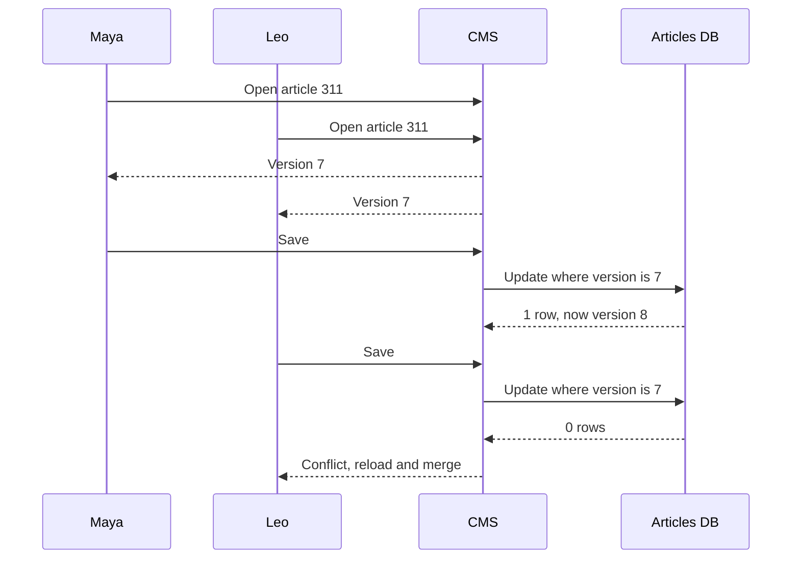

# Optimistic Locking

> Optimistic locking lets everyone read and edit freely, then rejects a save if someone else changed the data first. Nobody waits, and conflicts get caught instead of silently overwritten.

## How it works

Give each row a `version` number. When you read the row, remember its version, say 7. When you save, tell the database: update this row and set version to 8, but only if it's still 7. That's one statement, so nothing can sneak in between the check and the write.

If someone saved first, the version is already 8, your `WHERE` matches nothing, and the database reports 0 rows updated. That's your conflict. Reload the fresh data and retry, or show the user what changed.

The same trick shows up under other names:

- **Compare and swap.** A CPU instruction that sets a value only if it still equals what you expect. Lock free code is built on it.
- **ETags.** HTTP sends a version tag with a resource. You send it back in `If-Match`, and the server answers `412 Precondition Failed` if it changed.
- **Frameworks.** Database libraries do it for you: Rails with a `lock_version` column, Hibernate with a `@Version` field.

It's called optimistic because it bets conflicts are rare. When they are, it's cheap: no locks held, no waiting, and it's fine for a user to keep an edit form open for 10 minutes. When many writers fight over one row, most of them fail and retry, and the retries become the load. That's when pessimistic locking wins.

The catch: you have to check the row count. If your code ignores "0 rows updated" and returns success anyway, you've built optimistic locking that never catches anything.

## Example

A news site's editors share a CMS. Maya and Leo both open article 311 at version 7. Maya fixes a typo in the first paragraph and saves, so the article is now version 8.

Five minutes later, Leo saves a new headline along with his copy of the body. His save still says version 7:

```sql
UPDATE articles
SET headline = 'Storm closes coast road',
    body = :leos_copy, version = 8
WHERE id = 311 AND version = 7;
-- 0 rows updated
```

The CMS sees 0 rows and tells Leo the article changed while he was editing, with Maya's fix highlighted. He keeps her fix and reapplies his headline. Without the version check, his save would have quietly put the typo back.

## Picture it



Both editors start from version 7. Maya's save matches and bumps it to 8. Leo's save asks for version 7, finds nothing, and turns into a conflict instead of a silent overwrite.

## Related

[Pessimistic Locking](pessimistic-locking.md) · [Race Conditions](race-conditions.md) · [Isolation Levels](../07-databases/isolation-levels.md) · [Retries](../14-reliability/retries.md)
