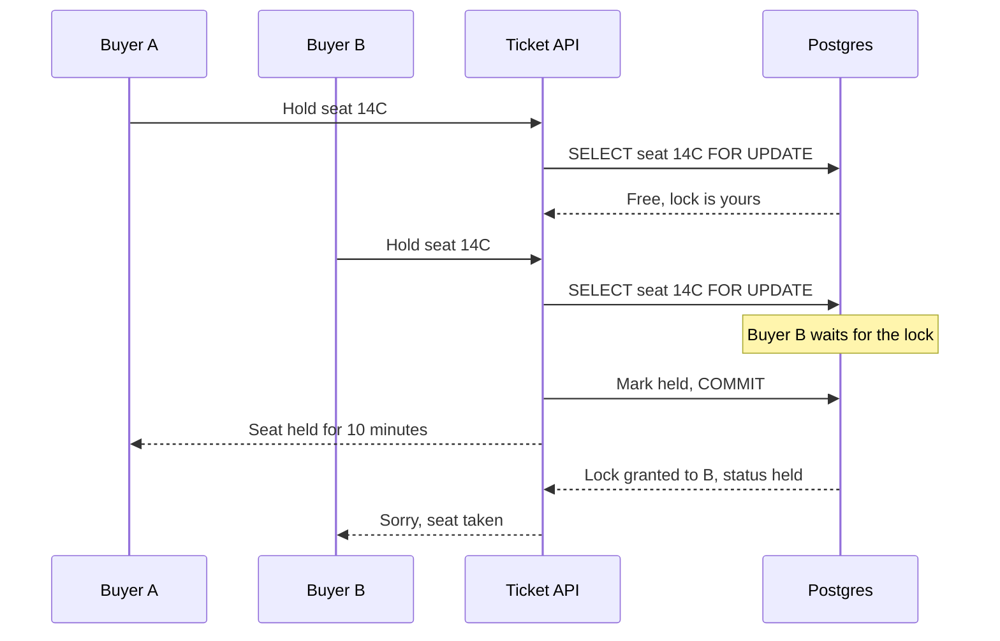

# Pessimistic Locking

> Pessimistic locking grabs a lock on the data before changing it, so anyone else who wants the same row waits their turn. It's the safe choice when many people fight over the same thing.



## How it works

Inside a transaction, read the row with `SELECT ... FOR UPDATE`. The database locks that row until you commit or roll back. Anyone else who tries to lock or change it blocks and waits. Plain reads usually still go through. Once you commit, the next waiter gets the lock and sees your changes.

It's called pessimistic because it assumes a conflict is coming and pays for safety up front. That pays off when conflicts are common: the last 50 seats of a concert, the stock count of a hyped sneaker, one account balance hit by many payments. Optimistic locking in those spots means most writers fail and retry, which is just a slower line.

A few knobs worth knowing:

- **NOWAIT.** Fail right away instead of waiting if the row is taken.
- **SKIP LOCKED.** Skip rows someone else holds. Perfect for workers pulling jobs from a table.
- **Lock timeout.** Give up after a set time, like 2 seconds, with `lock_timeout` in Postgres.

Postgres and MySQL 8 both support the first two.

The cost is waiting. A locked row serves one transaction at a time, so a hot row caps your throughput. Every waiter also ties up a database connection while it waits. And taking several locks opens the door to deadlocks.

The catch: never do slow work while holding the lock. Calling a payment API inside the transaction turns a 5 ms lock into a 2 second one, and everyone queued behind it waits those 2 seconds too.

## Example

A ticketing site opens sales for a big concert. Seat 14C gets 40 clicks in the same second. Each request runs:

```sql
BEGIN;
SELECT status FROM seats WHERE id = '14C' FOR UPDATE;
-- the other 39 requests wait here
-- if status is 'held': ROLLBACK and reply "taken"
UPDATE seats SET status = 'held', held_by = 812 WHERE id = '14C';
COMMIT;
```

The first buyer gets the hold in 4 ms. The next one gets the lock, sees `held`, and is told the seat is taken. 40 requests, one winner, no double booking.

Then someone moves the card charge inside the transaction "to keep it safe". The charge takes 1.5 seconds. Now every hot seat holds its lock for 1.5 seconds, all 50 database connections sit waiting, and the whole site stalls. The fix: hold the seat, commit, then charge the card outside the lock, with the hold expiring after 10 minutes.

## Picture it



Buyer B's request doesn't fail or overwrite anything. It waits a few milliseconds at the database, then sees the seat already held and gets a clean "taken" answer.

## Related

[Optimistic Locking](optimistic-locking.md) · [Deadlocks](deadlocks.md) · [Race Conditions](race-conditions.md) · [Connection Pooling](../07-databases/connection-pooling.md) · [Isolation Levels](../07-databases/isolation-levels.md)

---

[← Optimistic Locking](optimistic-locking.md) · [All concepts](../../README.md) · [Memory Leaks →](memory-leaks.md)
