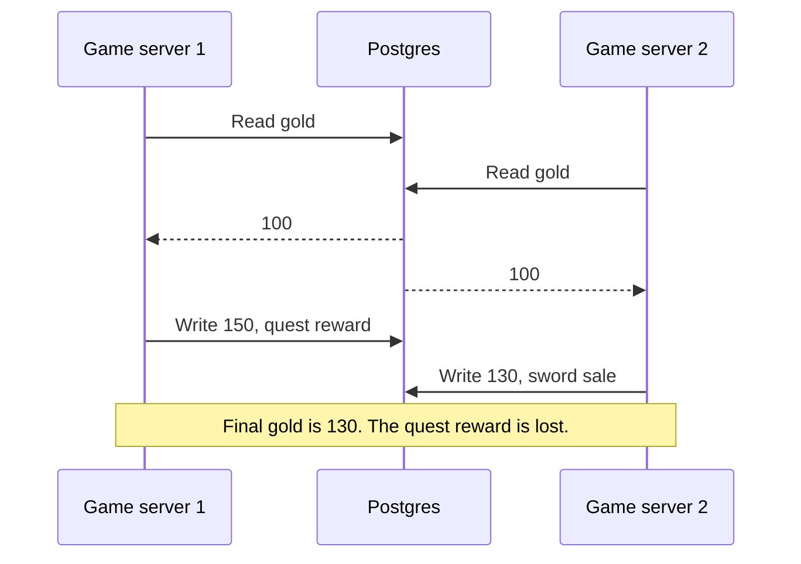

# Race Conditions

> A race condition is a bug where the result depends on which of two operations gets there first. It hides in testing and shows up under real traffic, usually as lost money or a double booking.



## How it works

Two shapes show up again and again:

- **Check then act.** "If the coupon is unused, apply it." Two requests both check, both see unused, both apply. The check was true when you looked and false by the time you acted.
- **Lost update.** Read a value, change it in your code, write it back. Two requests both read 100, each adds its bit, and the second write erases the first.

Inside one app, the racers are threads handling requests in parallel. Across servers, they're 4 copies of your API hitting the same database. The gap between check and act is often under a millisecond, which is why it almost never happens on your laptop and happens daily at 500 requests a second.

The fix is always to close that gap. Let the database read and write in one statement, like `SET gold = gold + 50` or `WHERE stock > 0`. Replace "check, then insert" with a plain insert and a unique constraint, which fails cleanly the second time. When the logic is too big for one statement, use optimistic locking (detect the conflict and retry) or pessimistic locking (make the second request wait).

The catch: a lock in your code only covers one process. A mutex around the coupon check works with one server. Scale to 4 and the race is back, now between machines. The lock has to live where the data lives, which usually means the database.

## Example

A multiplayer game keeps each player's gold in Postgres. Player 7 has 100 gold. She finishes a quest worth 50 and sells a sword for 30 at the same moment, and the two requests land on two different game servers. Both run the same code:

```python
gold = db.query("SELECT gold FROM players WHERE id = 7")  # 100
db.execute("UPDATE players SET gold = %s WHERE id = 7", gold + reward)
```

Server 1 writes 150. Server 2, which also read 100, writes 130. She should have 180. The quest reward is gone, and a support ticket is on its way.

The fix is one line. `UPDATE players SET gold = gold + 50 WHERE id = 7` lets Postgres do the read and the write together, so the two rewards stack and she ends at 180.

## Picture it



Both servers read before either one writes. The second write is based on a stale 100, so it quietly erases the first.

## Related

[Thread Safety](thread-safety.md) · [Optimistic Locking](optimistic-locking.md) · [Pessimistic Locking](pessimistic-locking.md) · [Isolation Levels](../07-databases/isolation-levels.md) · [Distributed Locks](../11-coordination/distributed-locks.md)

---

[← Saga Pattern](../11-coordination/saga-pattern.md) · [All concepts](../../README.md) · [Thread Safety →](thread-safety.md)
