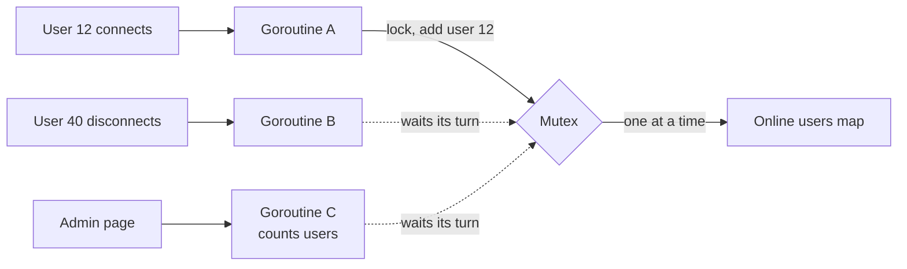

# Thread Safety

> Code is thread safe when it still works with many threads calling it at the same moment. The danger is always the same thing: data that is both shared and changing.

## How it works

A thread is one line of execution inside your program. A web server runs dozens at once, often one per request. They share the same memory, so when two touch the same variable, their steps interleave in ways you never wrote.

Even `count++` isn't one step. It's read, add 1, write. Two threads can both read 41 and both write 42. If data is shared and can change, pick one of these:

- **Mutex.** A lock that lets one thread at a time into a block of code. Simple and general. The cost is threads waiting in line, and deadlocks if you take two locks carelessly.
- **Atomics.** Special CPU instructions that read, change, and write one value as a single step. Great for counters and flags, useless for updating two things together.
- **Immutability.** Data that never changes can be shared with no locks at all. To "update" it, build a new copy and swap one reference to point at it.
- **Thread confinement.** Only one thread ever touches the data, and everyone else sends it messages. Node.js works this way: your code runs on one thread, so two handlers never touch a variable at the same instant. Go's channels are built for the same pattern.

The catch: thread safe parts don't add up to thread safe code. A concurrent map makes each single `get` and `put` safe. But "get, then put if missing" is two calls, and another thread can slip in between them. Use the one step version your library gives you, like `computeIfAbsent` on Java's `ConcurrentHashMap`.

## Example

A chat app tracks who is online in a Go map from user ID to connection. Each WebSocket connection runs in its own goroutine, Go's lightweight thread, and adds or removes its user on connect and disconnect.

It works in testing. Then at 9 in the morning, 20,000 people log on within a few minutes, two goroutines write the map at the same instant, and Go kills the whole process with `fatal error: concurrent map writes`. Every user is dropped at once, they all reconnect, and it happens again.

The fix is a mutex around the map:

```go
type Presence struct {
    mu    sync.Mutex
    users map[string]*Conn
}

func (p *Presence) Add(id string, c *Conn) {
    p.mu.Lock()
    defer p.mu.Unlock()
    p.users[id] = c
}
```

## Picture it



Three goroutines want the same map. The mutex lets goroutine A in and makes B and C wait a few microseconds, so the map never sees two writes at once.

## Related

[Race Conditions](race-conditions.md) · [Deadlocks](deadlocks.md) · [Optimistic Locking](optimistic-locking.md) · [WebSockets](../04-networking/websockets.md) · [Event Loop](event-loop.md)

---

[← Race Conditions](race-conditions.md) · [All concepts](../../README.md) · [Event Loop →](event-loop.md)
