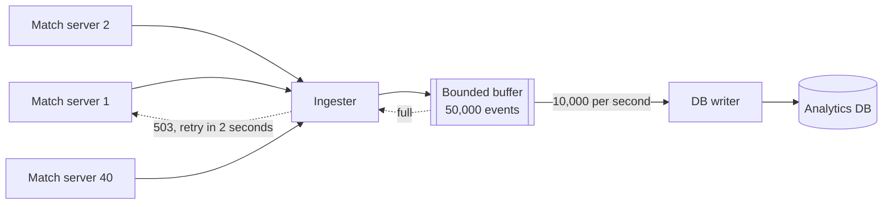

# Backpressure

> Backpressure is how a slow consumer tells a fast producer to ease off. Without it, the gap piles up in memory somewhere until that process crashes and takes all the buffered work with it.

## How it works

A pipeline runs at the speed of its slowest step. If a producer sends 15,000 events a second and the consumer handles 10,000, the extra 5,000 a second have to go somewhere. You get three options:

- **Buffer.** Hold the extra in a queue. Fine for a short burst, fatal for a steady gap if the queue has no size limit.
- **Drop.** Throw some away on purpose, ideally the least important ones. That's load shedding.
- **Push back.** Make the producer slow down. That's backpressure.

Pushing back usually starts with a bounded queue, one with a fixed maximum size. When it's full, the next write waits or gets rejected, and the producer feels it right away. Over HTTP, that's a `429` or `503` with a `Retry-After` header. TCP does it for free: a receiver that can't keep up shrinks its window, and the sender waits. Pull based systems like Kafka get it naturally, because consumers only fetch what they're ready for, and the backlog waits on disk instead of in RAM.

The tradeoff: pushing back doesn't make the work disappear. It moves the waiting upstream until it reaches something that can slow down, like a client that retries later, or something that has to drop work. You pick where that happens instead of letting a crash pick for you.

The catch: an unbounded in memory queue looks fine in every test. It hides the gap, latency creeps up as the line grows, and then the process runs out of memory at 3 AM with every buffered event inside it.

## Example

A multiplayer game has 40 match servers sending gameplay events to an analytics ingester. At peak they send 15,000 events a second. The ingester can write 10,000 a second to the database.

Before: the ingester accepts everything into an unbounded list in memory. The list grows by 5,000 events a second, about 300 MB a minute at 1 KB each. About 13 minutes into the Saturday peak it hits its 4 GB limit, crashes, and loses every queued event.

After: the ingester uses a bounded buffer of 50,000 events. When it's full, it answers `503` with `Retry-After: 2`. Match servers keep a small local batch, drop low value position pings if that fills up, and resend the rest after the pause. The ingester never crashes, the events that matter all arrive, and the rejection graph tells the team exactly when to add a second ingester.

## Picture it

Events flow in at up to 15,000 a second, but the writer only drains 10,000. When the bounded buffer fills, the dotted arrows carry the "slow down" signal back to the match servers instead of letting memory grow.

## Related

[Load Shedding](../14-reliability/load-shedding.md) · [Rate Limiting](../03-traffic/rate-limiting.md) · [Message Queues](message-queues.md) · [Little's Law](../01-performance/littles-law.md) · [Throughput](../01-performance/throughput.md)

---

[← Dead Letter Queues](dead-letter-queues.md) · [All concepts](../../README.md) · [Fan Out →](fan-out.md)
