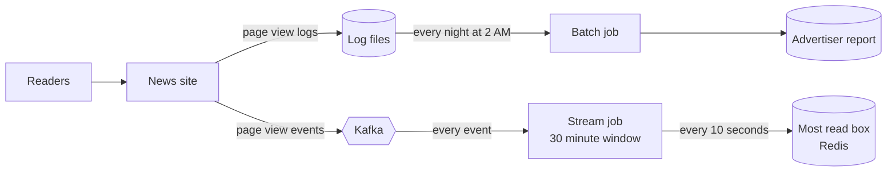

# Batch vs Stream Processing

> Batch processing crunches a big pile of data on a schedule, while stream processing handles each event the moment it arrives. Batch is simpler and cheaper, stream gives answers in seconds instead of hours.

## How it works

A batch job runs over a fixed chunk of data, like yesterday's logs. A scheduler starts it at 2 AM, it reads every file, writes the result, and exits. Spark jobs and plain SQL on a data warehouse are the usual tools. If it has a bug, you fix it and run it again over the same files.

A stream job never finishes. It sits on a feed of events, often a Kafka topic, and updates its results as each event lands. Flink and Kafka Streams are common here. The input never ends, so you compute over windows, like "views in the last 5 minutes", and the job keeps running totals in memory or on local disk.

| | Batch | Stream |
|---|---|---|
| Latency | Hours | Seconds |
| Input | Fixed set of files | Endless events |
| On failure | Rerun the job | Restore saved state, resume |
| Cost | Runs, then shuts off | Always on |

Streaming brings problems batch never has. Events arrive late and out of order: a phone that was offline sends its 10:00 events at 10:07, after that minute's window already closed. You need rules for how long to wait for stragglers and what to do with events that arrive even later.

Plenty of teams run both: a stream for the fast, roughly right number, and a nightly batch that recomputes the exact one.

The catch: picking streaming because it sounds modern. If someone reads the report once a day at 9 AM, a nightly batch gives them the same thing for a fraction of the effort. Stream only what a person or a system actually needs within minutes.

## Example

A news site shows a "Most read" box on its home page. A nightly batch job reads 40 GB of yesterday's page view logs at 2 AM and writes the top 10. It's cheap and it never breaks.

Then a huge story breaks at 9 AM. By noon it's the most read article on the site by far, and the box still shows yesterday's list. Readers notice.

The team adds a stream job. Every page view goes to Kafka, the job counts views per article over a sliding 30 minute window, and it writes the top 10 to Redis every 10 seconds. The next breaking story shows up in the box within a minute.

The nightly batch stays, but now it only feeds the advertiser report. That one needs exact counts, gets read once a day, and gains nothing from being fresher.

## Picture it

The same page views feed two paths. The batch path waits for a full day of files and runs once a night. The stream path handles every event and refreshes the box every 10 seconds.

## Related

[Event Streaming](event-streaming.md) · [Cron Jobs](cron-jobs.md) · [OLTP vs OLAP](../08-storage/oltp-vs-olap.md) · [Latency](../01-performance/latency.md) · [Cost Optimization](../22-operations/cost-optimization.md)

---

[← CQRS](cqrs.md) · [All concepts](../../README.md) · [Cron Jobs →](cron-jobs.md)
