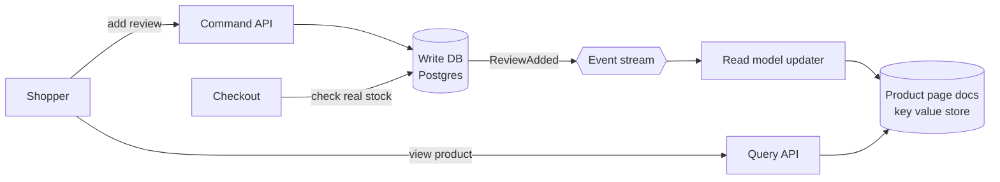

# CQRS

> CQRS, short for Command Query Responsibility Segregation, splits your data model in two: one shaped for writes and one shaped for reads. Each side gets fast at its own job, and reads can lag a little behind.

## How it works

Writes and reads want different things. A write needs rules checked: is the item in stock, is the price valid, can this user edit this product. That fits a normalized database, where every fact lives in exactly one place. A read wants everything for one screen in one fetch, already joined and sorted.

CQRS stops forcing one model to do both:

- **Commands.** Requests that change things, like "add review". They go to the write model, which checks the rules and saves the change.
- **Events.** Each saved change emits an event, like `ReviewAdded`.
- **Read models.** Separate tables or stores, one per screen if you like, kept up to date by consuming those events. A product page document in a key value store, a search index in Elasticsearch.
- **Queries.** Read only requests that go straight to a read model and never touch the write side.

The read side can scale on its own, use a different database, and be rebuilt from scratch by replaying the events.

The tradeoff is staleness. The read model updates after the write commits, usually within a second, but not instantly. A user who posts a review and reloads the page may not see it yet.

The catch: that lag looks like a bug to users. They think the click failed and do it again. Show the result the command returned, or read from the write side for a user's own changes for a few seconds. And skip CQRS for a plain admin screen, where one model was doing fine.

## Example

An online store's product page needs the product, its price, stock level, average rating, and review count. On the write database that's 5 joins and about 80 ms. At 3,000 page views a second, the database spends most of its time on those joins, and checkout writes start timing out.

The team adds a read model: one prebuilt document per product in a key value store, updated by a worker that listens for `PriceChanged`, `StockChanged`, and `ReviewAdded`. The product page now loads in 4 ms, and the write database only handles writes.

New reviews show up about a second late. Nobody minds. Stock is the one place they stay careful: the page shows "in stock" from the read model, but checkout always asks the write database before taking money.

## Picture it

Writes go through the command API into Postgres. Page views go through the query API to prebuilt documents. The event stream between them is where the lag lives, which is why checkout skips the read model and asks the write database directly.

## Related

[Event Sourcing](event-sourcing.md) · [Eventual Consistency](../10-distributed-systems/eventual-consistency.md) · [Read Replicas](../09-data-at-scale/read-replicas.md) · [Materialized Views](../07-databases/materialized-views.md) · [Change Data Capture](../09-data-at-scale/change-data-capture.md)
