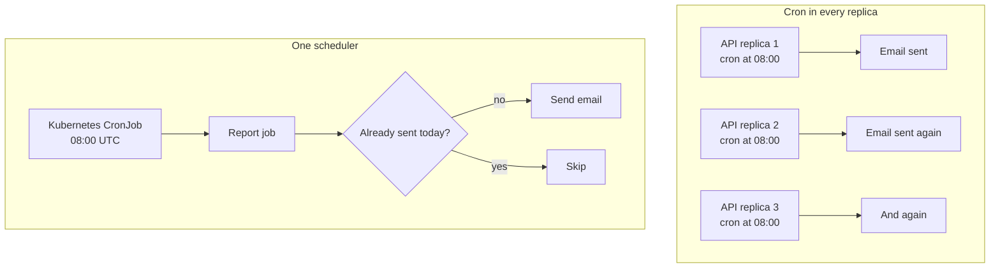

# Cron Jobs

> A cron job is a task that runs on a schedule, like "every day at 2 AM". Easy to set up, and easy to get wrong once your app runs on more than one server.



## How it works

Cron is the classic Unix scheduler. You give it a schedule like `0 2 * * *`, which means minute 0 of hour 2 every day, plus a command, and it runs the command on time. Apps do the same thing with a scheduler library inside the app, a Kubernetes CronJob, or a cloud scheduler.

On one server, that's the whole story. Real systems hit three more problems:

- **Overlapping runs.** An hourly job takes 70 minutes one day. The next run starts before the last one ends, and both fight over the same rows.
- **Missed runs.** The server was restarting at 2:00, so the job never ran. Nothing failed, so no alert fired.
- **Double runs.** Even a dedicated scheduler can occasionally start the same run twice. The Kubernetes docs say so outright.

The fixes are boring and they work. Run the schedule in exactly one place. Forbid a new run while the last one is still going. Alert when a job hasn't succeeded on time, not just when it errors, because a job that never started never errors. And make every job idempotent, so running it twice does no harm. Key the work by date: "usage report for October 16 already sent? Skip."

The catch: putting the scheduler inside your web app. It works perfectly with one copy of the app. The day you scale to 3 replicas, every replica runs the job, and every customer gets the same email three times.

## Example

A SaaS dashboard emails each customer a usage summary at 08:00 UTC. The scheduler is a cron library inside the API server, which was fine while there was one server.

A busy Monday pushes autoscaling to 3 replicas. At 08:00 each one wakes up and sends the summary. 12,000 customers get 3 emails each, and a few reply asking whether they've been hacked.

The fix: move the job out of the API and into a Kubernetes CronJob, so exactly one scheduler exists. Then add a `sent_reports` table keyed by customer and date, so even a duplicate run skips anyone already emailed.

```yaml
kind: CronJob
spec:
  schedule: "0 8 * * *"
  timeZone: "Etc/UTC"
  concurrencyPolicy: Forbid
  startingDeadlineSeconds: 3600
```

`Forbid` stops overlapping runs. The deadline lets a run start up to an hour late. Anything later is skipped, so nobody gets a morning summary in the afternoon.

## Picture it



When the schedule lives inside the app, every replica fires at 08:00 and one email becomes three. With one scheduler there's one job, and the "already sent" check makes even a rare double run harmless.

## Related

[Distributed Locks](../11-coordination/distributed-locks.md) · [Leader Election](../11-coordination/leader-election.md) · [Idempotency](../14-reliability/idempotency.md) · [Batch vs Stream Processing](batch-vs-stream-processing.md) · [Kubernetes](../19-build-and-infra/kubernetes.md)

---

[← Batch vs Stream Processing](batch-vs-stream-processing.md) · [All concepts](../../README.md) · [Timeouts →](../14-reliability/timeouts.md)
