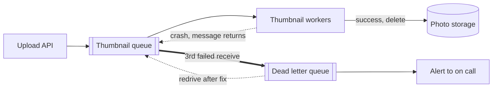

# Dead Letter Queues

> A dead letter queue is where messages go after failing too many times. It keeps one broken message from tying up your workers forever, and parks it somewhere a human can look at it.

## How it works

Some messages will never succeed. A photo with a corrupt header, a field your code can't parse, an order for a product that was deleted. These are poison messages. With at least once delivery, a failing message goes back on the queue and gets retried, again and again. It eats worker time, floods logs with the same error, and in a strictly ordered queue it blocks everything behind it.

A dead letter queue, or DLQ, is a plain second queue plus a rule:

- **Max receive count.** In SQS, a redrive policy says "after 5 failed receives, move it to the DLQ". RabbitMQ does the same job with dead letter exchanges. Plain Kafka consumers have nothing built in, so they write failures to a separate topic themselves.
- **Alerting.** A healthy DLQ is empty. Alert when its depth goes above zero, not when it hits 10,000.
- **Redrive.** Once the bug is fixed, move the messages back to the main queue so they get processed. SQS has a button and an API call for this.

Set the max high enough to ride out a short blip, like a database restart, and low enough that a poison message doesn't burn an hour. Somewhere from 3 to 10 is common.

Watch out: a DLQ nobody watches is data loss with extra steps. SQS deletes messages after the retention period, 4 days by default, and in a standard queue a message keeps its original timestamp when it moves to the DLQ. Give the DLQ a longer retention than the source queue, and actually wire up that alert.

## Example

A photo sharing app makes thumbnails with 10 workers reading from SQS. A buggy camera app update produces images with a corrupt header, and the image library crashes on every one of them.

Without a DLQ, each bad message comes back every 30 seconds until it expires days later. By the afternoon there are 400 of them, the workers spend most of their time crashing, and normal uploads wait 20 minutes for a thumbnail.

With a redrive policy, each bad file gets 3 tries and then moves aside:

```json
"RedrivePolicy": {
  "deadLetterTargetArn": "arn:aws:sqs:us-east-1:123456789012:thumbnails-dlq",
  "maxReceiveCount": 3
}
```

Normal uploads stay fast. The alert fires on the first bad file, an engineer patches the decoder the next morning, and redrives all 400. Every user gets a thumbnail, a day late but intact.

## Picture it



A failing message loops between the queue and the workers until it hits the receive limit. Then the thick arrow moves it aside, the alert tells someone, and the dotted redrive sends it back once the bug is fixed.

## Related

[Message Queues](message-queues.md) · [Retries](../14-reliability/retries.md) · [Delivery Guarantees](delivery-guarantees.md) · [Alerts](../18-observability/alerts.md) · [Exponential Backoff](../14-reliability/exponential-backoff.md)

---

[← Delivery Guarantees](delivery-guarantees.md) · [All concepts](../../README.md) · [Backpressure →](backpressure.md)
