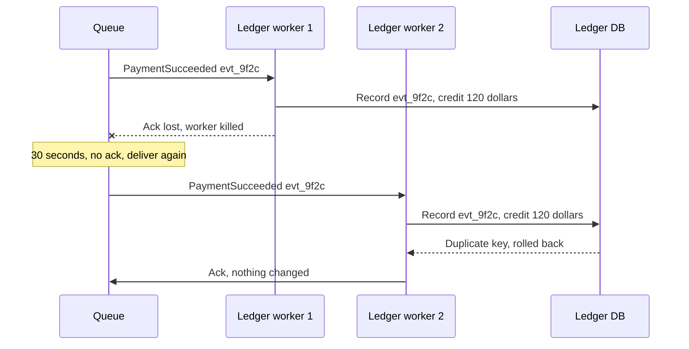

# Delivery Guarantees

> A delivery guarantee tells you how a messaging system fails: it may lose a message, or it may deliver one twice. Knowing which one you have decides whether you drop orders or charge people twice.

## How it works

A broker hands a message to a consumer and waits for an ack, a short "done". Failures hit in the gap: the consumer crashes halfway, or finishes the work and dies before acking. When the consumer acks decides what you get.

- **At most once.** Ack as soon as the message arrives, then do the work. A crash loses the message, but nothing ever happens twice. Fine for metrics or a live location ping, where the next one is a second away.
- **At least once.** Ack only after the work is done. A crash means redelivery, so nothing is lost, but some messages get processed twice. This is the default for SQS and for most Kafka and RabbitMQ setups.
- **Exactly once.** Every message has its effect once. Across a network, no broker can promise that for your side effects on its own.

What you actually build is effectively once: at least once delivery plus an idempotent consumer, one that can safely see the same message twice. Each message carries a unique ID, and the consumer records it in the same database transaction as the work. A repeat finds its ID already there and gets skipped.

Ordering is a separate promise. One global order means one consumer at a time, so most systems only keep order per key: per partition in Kafka, per message group in SQS FIFO queues. Retries can still shuffle things, so carry a version number and ignore anything older than what you already applied.

The catch: "exactly once" on a product page usually means inside that product. Kafka transactions cover reading from Kafka and writing back to Kafka. The moment your consumer charges a card or sends an email, you're back to at least once plus your own dedupe.

## Example

A payments API publishes a `PaymentSucceeded` event, and a ledger service consumes it to credit the merchant's balance.

One afternoon a ledger worker credits a merchant $120, then gets killed by a deploy before it acks. The message becomes visible again 30 seconds later, and another worker credits the same $120. The merchant is $120 richer than they should be, and finance finds it a week later.

The fix is a `processed_events` table with the event ID as its primary key, written in the same transaction as the credit:

```sql
BEGIN;
INSERT INTO processed_events (event_id) VALUES ('evt_9f2c');
UPDATE balances SET cents = cents + 12000 WHERE merchant_id = 88;
COMMIT;
```

The second delivery hits a duplicate key, rolls back, and gets acked without touching the balance.

## Picture it



The first worker did the work but never acked, so the queue delivers the same event again. That's at least once doing its job. The dedupe table turns the second delivery into a no op, which is all effectively once means.

## Related

[Idempotency](../14-reliability/idempotency.md) · [Message Queues](message-queues.md) · [Retries](../14-reliability/retries.md) · [Outbox Pattern](outbox-pattern.md) · [Two Generals Problem](../23-laws/two-generals-problem.md)
