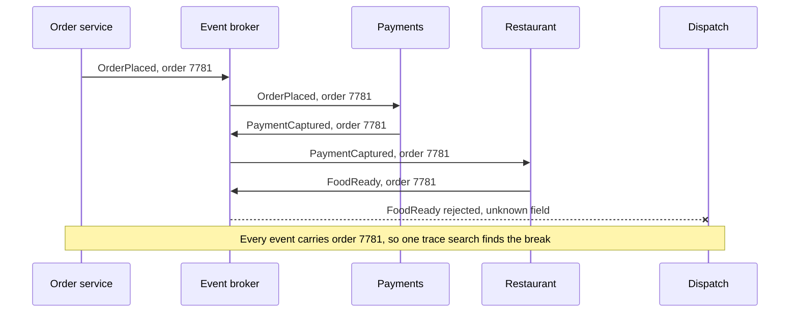

# Event Driven Architecture

> In an event driven architecture, services announce what happened instead of telling each other what to do. Others react on their own, which keeps teams decoupled but makes the overall flow much harder to see.

## How it works

In a request driven system, the order service calls payments, then the restaurant, then dispatch, and waits for each answer. It knows every step and every service. If one is down, the order fails.

In an event driven system, the order service publishes `OrderPlaced` to a broker and moves on. Payments hears it, charges the card, and publishes `PaymentCaptured`. The restaurant hears that and starts cooking. Nobody calls anybody. Each service only knows which events it cares about.

Events are facts, named in the past tense. A few choices shape the design:

- **Thin events.** Carry just an ID. Consumers call back for details, which adds load and quietly couples them again.
- **Fat events.** Carry the data consumers need, so nobody calls back. The event's fields become a contract you can't change casually.
- **Choreography or orchestration.** Choreography lets services react to each other with no boss. Orchestration puts one coordinator in charge, which is easier to follow once a flow has more than a handful of steps.

What you gain: services deploy and scale on their own, a slow service doesn't block the others, and adding a new reaction means adding a subscriber. What you lose: the flow no longer lives in one place. It's spread across a dozen handlers in a dozen repos, and every step is eventually consistent.

The catch: when an order gets stuck, there's no stack trace to read. You end up searching logs in six services to find which one dropped it. Put a correlation ID, like the order ID, on every event from day one, and use distributed tracing so you can see the whole chain.

## Example

A food delivery app has 5 services that react to orders: payments, restaurant, dispatch, notifications, and loyalty points. The order service used to call all 5 in a row. A 30 second outage in loyalty points meant 30 seconds of failed orders, for a feature nobody was waiting on.

After the switch, the order service publishes `OrderPlaced` and replies in 50 ms. When loyalty goes down, it catches up later and nobody notices.

Then a customer's order sits on "Preparing" for 40 minutes. The restaurant cooked it, but no courier came. Dispatch had been rejecting every `FoodReady` event since the restaurant team renamed `restaurant_id` to `store_id`. Because every event carries the order ID, an engineer pulls up the trace for that order and finds the failing handler in 5 minutes. Without it, that's an afternoon of digging through logs.

## Picture it

No service calls another. Each one hears an event and publishes the next. The chain breaks silently at dispatch, and the only thing tying the steps together is the order ID every event carries.

## Related

[Pub/Sub](pub-sub.md) · [Saga Pattern](../11-coordination/saga-pattern.md) · [Distributed Tracing](../18-observability/distributed-tracing.md) · [Eventual Consistency](../10-distributed-systems/eventual-consistency.md) · [Monolith vs Microservices](../15-architecture/monolith-vs-microservices.md)
